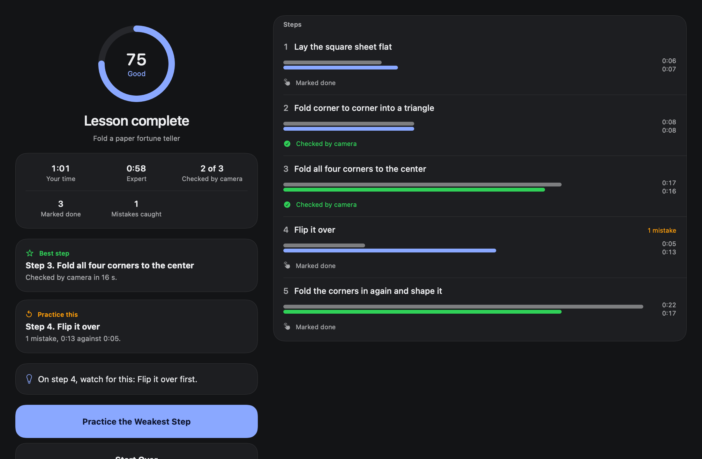

<div align="center">


# HandOver

A how-to video that waits for you.

[Website](https://handover.sohamaggarwal.com) ·
[Install](docs/install.md) ·
[Docs](docs/README.md) ·
[Privacy](docs/privacy.md)


</div>

An expert does a task once on camera, for example wearing Meta glasses. HandOver cuts the take into steps, each with its own clip, captions and voiceover. A learner then points a phone or laptop camera at their hands, watches the expert's clip for the current step, and the lesson moves on when the camera shows the step is done.

Everything runs on one laptop on the local network. Learner frames stay in memory and are never saved.

## How it works

**Teach.** Record or upload a take. The pipeline finds the step boundaries, cuts a clip per step, writes timed captions, picks a reference frame that shows what "done" looks like, drafts a yes/no question a camera can answer, and speaks a short voiceover with a local TTS model. An editor lets you fix cuts, titles, questions and safety notes afterwards, with undo.

**Learn.** The screen shows the expert's clip beside the learner's live camera. When the hands settle, the hub compares the newest frame with the step's reference and asks a vision model whether the step is done. Two confident yeses on different frames advance the lesson, with a chime and a spoken cue. A guess never moves it forward, and Next always works. If the learner is still on the previous step after a few seconds, the screen names it and says the common mistake out loud.

**Review.** The done screen shows the learner's time per step against the expert's and which steps the camera verified. Events are written to a local file. Export to Databricks is optional and off unless credentials are set.

Camera checks are limited to what a frame can show: shape, position, seams, counts. Steps that can't be judged from a photo are marked manual rather than passed by accident.

| Build the course | Learn with the camera | Review |
| :---: | :---: | :---: |
|  |  |  |

Screenshots use the bundled origami demo lesson.

## Quickstart

You need Python 3.12, [uv](https://docs.astral.sh/uv/), Node.js 20+ and ffmpeg.

```sh
uv venv --python 3.12 .venv
uv pip install --python .venv/bin/python -r server/requirements.lock
npm --prefix web ci
npm --prefix web run build

# Mock checks: no model key, no network.
HANDOVER_CHECK=mock HANDOVER_NO_NETWORK=1 scripts/run_server.sh
```

Open <http://localhost:8000> and pick a bundled lesson. To run a whole session without a camera, replay a take as the learner:

```sh
.venv/bin/python -m server.replay lessons/fortune-teller-v2/norm.mp4 --select fortune-teller-v2
```

For real checks, copy `.env.example` to `.env`, add `ANTHROPIC_API_KEY` or `GEMINI_API_KEY`, and start the hub without `HANDOVER_CHECK=mock`. Keys stay in `.env`; the API never returns them.

Phone browsers need HTTPS to open the camera. On macOS, `scripts/certs.sh` makes a local certificate and tells you how to trust it. Windows setup is in [CONTRIBUTING.md](CONTRIBUTING.md).

## Apps

The hub is the source of truth. Every app is a viewer of it and can be its camera.

- **Mac and Windows:** the desktop app (Tauri, Rust core) runs the workspace and the hub. [Download](https://handover.sohamaggarwal.com/install) or build from `apps/desktop`.
- **iPhone and iPad:** SwiftUI app, built with Xcode and your own signing team. Streams the phone camera and bridges the Meta Wearables Device Access Toolkit for glasses. Not on the App Store or TestFlight.
- **Android:** Kotlin and Compose. APK on the download page, or build with Gradle.
- **Browser:** the full learner view at the hub's address, plus a capture page for phones.

Glasses streaming is a developer build. A signed iPhone build has registered a Ray-Ban Meta Gen 2 through Meta's Developer Mode and carried its camera into the hub; it has not been tested across phones or firmware. Build, signing and pairing steps are in [docs/install.md](docs/install.md).

## Architecture

One Python process (FastAPI, uvicorn, websockets) serves the lesson files, the web app, a camera socket and a UI socket. Cameras send JPEG frames; the hub keeps only the newest one per camera, in memory. A motion gate lets a frame through once the picture has settled, and a check runs against the configured vision provider with the step's reference frame and the live frame. Clients get the lesson state over WebSockets. Analytics write to a local JSON lines file and never sit in the live path.

The wire format is in [CONTRACT.md](CONTRACT.md). The full write-up of how the teach pipeline, the learn loop and the data layer work, with the numbers behind the design choices, is [docs/project.md](docs/project.md).

## Privacy

The hub never saves learner camera frames. A check sends the step's reference frame and one live frame to the vision provider you configured, and nothing else leaves the laptop unless you turn Databricks export on. The local event log holds run metadata only: no images, audio, IP addresses, tokens or device identifiers. The expert's take and clips are lesson content and are stored as such.

Details in [docs/privacy.md](docs/privacy.md) and [docs/analytics.md](docs/analytics.md).

## Tests

The hub, protocol, library, privacy and failure paths have pytest suites. The web app has a TypeScript build and a Playwright flow that drives a real hub with a replayed camera. The Apple, Android and desktop apps each have unit and snapshot tests. What is covered automatically and what still needs a person is listed in [docs/validation.md](docs/validation.md). Anything that is a mock, replay or synthetic fixture is labelled as one.

## More

- [Documentation index](docs/README.md)
- [Install and connect](docs/install.md)
- [Troubleshooting](docs/troubleshooting.md)
- [Hub setup and internals](server/README.md)
- [Desktop app](apps/desktop/README.md)
- [Databricks runbook](databricks/README.md)
- [Contributing](CONTRIBUTING.md)

## License

[MIT](LICENSE) © 2026 Soham Aggarwal
