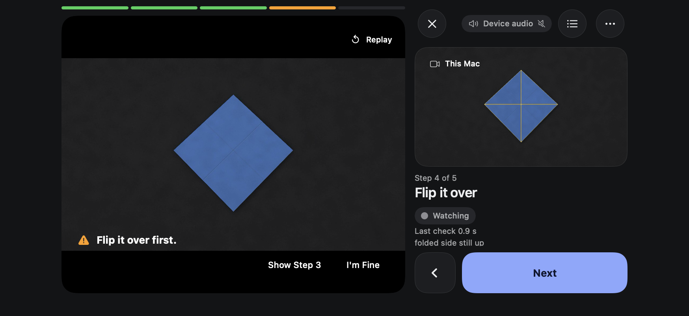
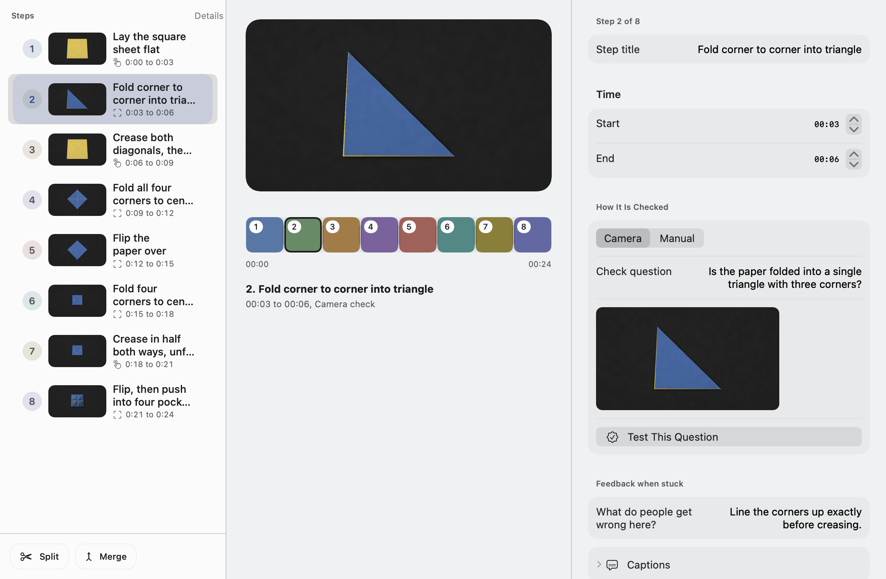
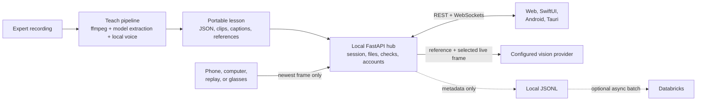

<div align="center">


# HandOver

**A course that moves when you do.**

Turn one expert recording into a step-by-step course. HandOver shows the expert's motion beside the learner's hands, watches for visible progress, and advances when the step is complete.

[Website](https://handover.sohamaggarwal.com) ·
[Install](docs/install.md) ·
[Documentation](docs/README.md) ·
[Privacy](docs/privacy.md)




<sub>The learner sees the expert motion, the camera's current state, and one clear correction without leaving the step.</sub>

</div>

> [!IMPORTANT]
> HandOver is an active research prototype, not a safety system. Phone, laptop, browser, and replay paths have automated coverage. A signed development build has registered a Ray-Ban Meta Gen 2 through Meta AI Developer Mode and carried its live camera into HandOver. That is evidence for this specific setup, not a production hardware matrix or store-ready integration.

## What it does

| | What HandOver provides |
| --- | --- |
| **Teach** | Upload or record an expert take. The pipeline finds steps, cuts replayable clips, writes captions, selects reference frames, drafts camera-checkable questions, and can add local voiceover. |
| **Learn** | Keep the expert clip large while the learner's phone, computer, replay, or supported glasses camera supplies a live view. Pause, replay, scrub, go back, or advance manually at any time. |
| **Check** | Wait for the hands to settle, compare the latest frame with the step's references, and advance only on a confident visible result. A concise correction appears when the learner still matches the previous state. |
| **Author** | Adjust cuts, titles, questions, manual steps, safety notes, and course metadata in the editor, with revision-aware clients and undo/redo. |
| **Review** | Show pace, camera-verified steps, manual advances, caught mistakes, and a step-by-step completion review. Events stay local unless optional Databricks export is configured. |

Camera judgment is deliberately limited to what a frame can show: shape, position, seams, counts, and visible completion. A step that cannot be judged honestly remains manual.

## The course loop

| Build the course | Learn with live feedback | Review and practice |
| :---: | :---: | :---: |
|  |  |  |
| Refine the cuts and checks. | Follow the motion; HandOver watches the result. | See what passed, what took time, and what to retry. |

These are repository-owned application snapshots rendered from a bundled synthetic origami fixture. Names, timing, scores, and learner results are demo data; screenshots do not establish a physical-device or model-accuracy claim.

## Install the apps

HandOver is a local system: one Mac or PC runs the hub, and any connected screen can follow the same lesson.

| Platform | Current path | What it does |
| --- | --- | --- |
| **Mac** | [Download page](https://handover.sohamaggarwal.com/install) or build the desktop/Apple target | Runs the workspace and local hub; can also use its camera. |
| **iPhone / iPad** | Build the Apple app with Xcode and your own signing team | Follows the course, streams the phone camera, and bridges the Meta Wearables toolkit. |
| **Android** | APK on the download page or build with Gradle | Follows the course and streams the phone camera; the wearable path remains a developer build. |
| **Browser** | Open the hub on the local network | Full learner view; phone camera capture requires trusted local HTTPS. |

The exact source-build, signing, pairing, and Meta Developer Mode steps are in [docs/install.md](docs/install.md). The iPhone app is not on the App Store or TestFlight; Xcode is the honest install path today.

## Quickstart

For deterministic local development, install Python 3.12, [uv](https://docs.astral.sh/uv/), Node.js 20+, npm, and ffmpeg. Then run:

```sh
uv venv --python 3.12 .venv
uv pip install --python .venv/bin/python -r server/requirements.lock
npm --prefix web ci
npm --prefix web run build

# No model key, network call, or paid inference.
HANDOVER_CHECK=mock HANDOVER_NO_NETWORK=1 scripts/run_server.sh
```

Open <http://localhost:8000> and choose a bundled lesson. To drive a complete session without camera hardware:

```sh
.venv/bin/python -m server.replay lessons/fortune-teller-v2/norm.mp4 \
  --select fortune-teller-v2
```

Mock mode advances camera-checkable steps on a timer. For real checks, copy `.env.example` to `.env`, add either `ANTHROPIC_API_KEY` or `GEMINI_API_KEY`, and restart without `HANDOVER_CHECK=mock`. Keys stay in `.env` and are never returned by the API.

Phone browsers need HTTPS for camera access. On macOS, run `scripts/certs.sh` once and follow its trust instructions. Native phone apps connect directly to the hub over the local network. Windows setup and the contributor workflow are in [CONTRIBUTING.md](CONTRIBUTING.md).

## Architecture



The laptop hub is the source of truth for the active course, step, check result, and connected cameras. Learner frames are newest-only in memory. Clients receive synchronized state over WebSockets, while optional analytics run outside the live path and cannot block a lesson. The additive wire contract is documented in [CONTRACT.md](CONTRACT.md); the complete system narrative is [docs/project.md](docs/project.md).

## Privacy

- **Learner frames are transient.** The hub keeps only the latest frame in memory and never adds frames or audio to analytics.
- **Checks are explicit network use.** The configured vision provider receives the reference material and selected live frame needed for a check. Expert recordings and derived course media are stored as course content.
- **Analytics are metadata only.** Local events exclude raw images, audio, IP addresses, auth tokens, camera names, and stable device identifiers.
- **Databricks is optional.** Export is asynchronous, retry-safe, and disabled when credentials are absent.

Read [docs/privacy.md](docs/privacy.md) before using real learner data and [docs/analytics.md](docs/analytics.md) before enabling an external sink.

## Validation

| Surface | Evidence in this repository | Still manual |
| --- | --- | --- |
| Hub and protocol | Engine, contract, library, privacy, source, ordering, and failure-path suites | Provider behavior and latency on the intended network and course |
| Web | TypeScript build and Playwright hub/replay flow | Target browser, camera, and certificate matrix |
| Apple, Android, desktop | Unit/UI tests, snapshots, protocol fixtures, and platform builds | Release signing, installers, and physical-device matrix |
| Meta camera | Toolkit lifecycle/source tests plus one signed Ray-Ban Meta Gen 2 live-flow run | Sustained repeatable sessions across claimed phones, firmware, and glasses |
| Analytics | Redaction, local sink, schema adapter, aggregation, and failure-isolation tests | Workspace permissions, dashboards, and production retention policy |

[docs/validation.md](docs/validation.md) lists the exact commands, evidence levels, and release checklist. A mock, replay, snapshot, or synthetic fixture is always labeled as such.

## Documentation

- [Documentation index](docs/README.md)
- [Install and connect](docs/install.md)
- [Troubleshooting](docs/troubleshooting.md)
- [System narrative](docs/project.md)
- [Hub setup and internals](server/README.md)
- [Protocol contract](CONTRACT.md)
- [Contributor guide](CONTRIBUTING.md)
- [Desktop app](apps/desktop/README.md)
- [Databricks runbook](databricks/README.md)

Contributions are welcome. Keep changes offline-testable, preserve the learner-frame privacy boundary, and update the contract and relevant guides when a wire shape changes.

## License

[MIT](LICENSE) © 2026 Soham Aggarwal
