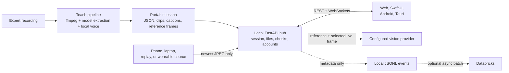

# HandOver

**A camera-aware course player for hands-on work.** Record a task once, turn it into short teachable steps, and let a learner's camera advance the lesson when each step is complete.

HandOver combines an expert recording, a local hub, and a choice of phone, laptop, replay, or integrated wearable camera source. The hub keeps the live lesson synchronized across screens, checks visible progress, catches common mistakes, and records privacy-conscious learning events for review.

> [!IMPORTANT]
> HandOver is an active prototype, not a safety system. Phone, laptop, browser, and replay paths have automated coverage. A Ray-Ban Meta Gen 2 has been registered through the signed iOS app in Developer Mode and its live camera has reached the local HandOver flow. That proves this specific development setup, not a production hardware matrix or store-ready integration.


| Build and refine the course | Review a completed run |
| --- | --- |
|  |  |

_Repository-owned application snapshots generated by the Apple snapshot suite from a bundled synthetic origami fixture. They show implemented UI states; the lesson names, people, scores, and timings are demo data, not production learner results or proof of a physical-glasses run._

## What it does

- **Teach:** normalize a recording, find steps, cut clips, generate captions and reference frames, and optionally add local voiceover.
- **Learn:** show the learner's live camera beside the expert clip, advance on verified progress, and always keep manual controls available.
- **Correct:** compare the live view with adjacent reference states and surface a concise, course-authored mistake cue.
- **Author:** edit step boundaries, questions, check type, safety notes, and course metadata with revision-aware clients.
- **Review:** keep run, check, timing, source, replay, interruption, and completion events locally; optionally batch redacted events to Databricks.

## Architecture



The laptop hub is the source of truth for the active lesson. Camera frames are held in memory, newest-only; clients receive synchronized state over WebSockets. Databricks is outside the live loop, so analytics availability cannot block a lesson. The wire contract is documented in [CONTRACT.md](CONTRACT.md).

## Run locally

Prerequisites: Python 3.12, [uv](https://docs.astral.sh/uv/), Node.js 20+, npm, and ffmpeg on `PATH`.

```sh
uv venv --python 3.12 .venv
uv pip install --python .venv/bin/python -r server/requirements.lock
npm --prefix web ci
npm --prefix web run build

# Deterministic offline mode: no model key and no paid calls.
HANDOVER_CHECK=mock HANDOVER_NO_NETWORK=1 scripts/run_server.sh
```

Open <http://localhost:8000>, choose a bundled lesson, and connect a camera. To exercise the entire session without camera hardware:

```sh
.venv/bin/python -m server.replay lessons/fortune-teller-v2/norm.mp4 \
  --select fortune-teller-v2
```

Mock mode advances camera-checkable steps on a timer. For real checks, copy `.env.example` to `.env`, set either `ANTHROPIC_API_KEY` or `GEMINI_API_KEY`, and start the hub without `HANDOVER_CHECK=mock`. Keys must stay in `.env` and are never returned by the API.

Phone browsers require HTTPS for camera access. On macOS, run `scripts/certs.sh` once and follow its trust instructions. Native phone apps connect directly over the local network. Windows setup and the full contributor path are in [CONTRIBUTING.md](CONTRIBUTING.md).

## Validation at a glance

| Surface | Automated or local evidence | Still requires real-world validation |
| --- | --- | --- |
| Hub and protocol | Engine, contract, library, privacy, camera-source, and failure-path suites | Provider behavior and latency under the intended network/load |
| Web learning flow | TypeScript build plus Playwright hub/replay flow | Target browser, camera, and certificate combinations |
| Apple, Android, desktop | Unit/UI tests and platform builds; shared contract fixtures | Release signing, installers, and a device matrix |
| Meta camera source | Toolkit adapters, source selection, client tests, and a signed Ray-Ban Meta Gen 2 + iPhone live-flow run | Repeatable sustained runs across supported phones, glasses firmware, and network conditions |
| Analytics | Local sink, redaction, schema adapter, profile aggregation, and failure isolation tests | Workspace credentials, dashboard permissions, and production retention policy |

See [docs/validation.md](docs/validation.md) for commands, evidence levels, and the release checklist.

## Privacy and analytics

Learner frames are transient: the hub keeps only the newest frame in memory and does not add frames or audio to analytics. A configured vision provider receives the reference material and selected live frame needed for a check. Expert recordings and derived lesson media are stored as course content.

Operational and learning events are written to a local JSONL mirror. They exclude raw images, audio, IP addresses, auth tokens, camera names, and stable device identifiers. Optional Databricks export is asynchronous, retry-safe, and can be disabled by leaving its credentials unset. Read [docs/privacy.md](docs/privacy.md) before using real learner data and [docs/analytics.md](docs/analytics.md) for the event model and retention controls.

## Documentation

- [Documentation index](docs/README.md)
- [System narrative and design decisions](docs/project.md)
- [Hub setup and internals](server/README.md)
- [Protocol contract](CONTRACT.md)
- [Contributor guide](CONTRIBUTING.md)
- [Privacy](docs/privacy.md) and [analytics](docs/analytics.md)
- [Desktop app](apps/desktop/README.md) and [Databricks runbook](databricks/README.md)

Contributions are welcome. Keep changes offline-testable, preserve the privacy boundary, and update the contract and relevant documentation when a wire shape changes.

HandOver is open source under the [MIT License](LICENSE).
