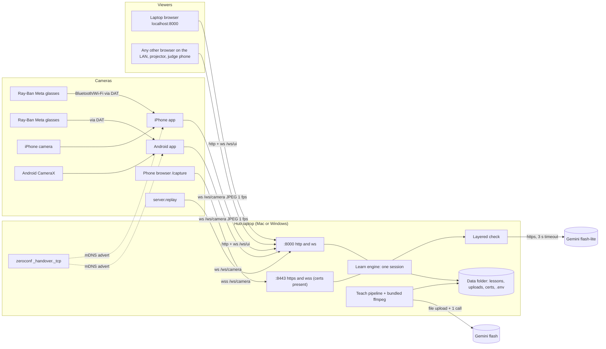
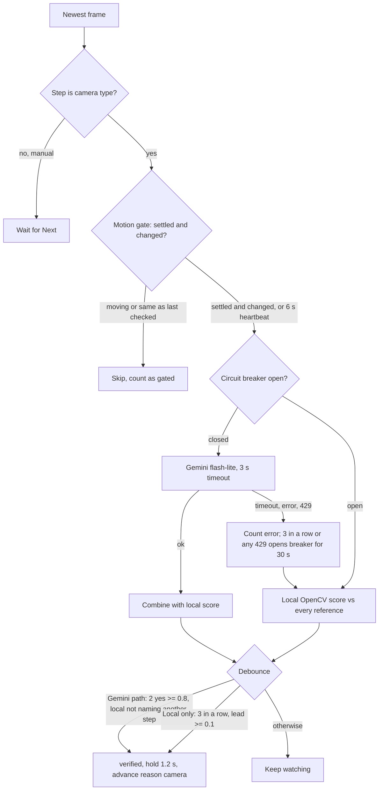

# HandOver architecture

Status: written 2026-11-14 against the code in this repo. Hacking ends Sunday 2026-11-15 12:00 PM. The interface itself is in `docs/CONTRACT_V2.md`; this file explains where each piece runs and why.

## 1. One sentence

One laptop runs the hub (a Python server). Phones and glasses are cameras that send JPEG frames to it. Any browser on any device is a viewer. Every client talks to the hub only through the HTTP and WebSocket contract, so every OS works with every other OS.

## 2. Components and where each runs

| Component | Runs on | Code | Status |
|---|---|---|---|
| Hub server (REST, WebSockets, learn engine, check, teach pipeline) | Mac or Windows laptop (Linux works from source) | `server/main.py`, `server/check.py`, `server/teach.py` | EXISTS |
| Built web app (Learn, Teach, Connect, Done) | Served by the hub, opened in Chrome, Edge or Safari | `web/src/*`, built to `server/static/app/` | Web app EXISTS; serving it from the hub is NEW |
| Browser capture page | Any phone browser over https 8443 | `server/static/capture.html` | EXISTS |
| Desktop launcher (data folder, certs, zeroconf, browser, QR window) | Inside the frozen Mac and Windows app | `server/launcher.py`, `server/discovery.py` | NEW |
| iPhone app (glasses via Meta DAT iOS 1.0.1, or the phone camera) | iPhone, iOS 17.2+ | `apps/ios/` (xcodegen) | NEW |
| Android app (glasses via Meta DAT Android 1.0.1, or CameraX) | Android, minSdk 31 | `apps/android/` (Gradle, Kotlin) | NEW |
| Replay camera | Any machine with Python and ffmpeg | `server/replay.py` | EXISTS |
| Smoke test (CI and local) | CI runners, the Mac | `scripts/smoke.py` | NEW |

Decision: no Tauri and no Electron this weekend. Chrome Web Speech (the "next" voice command) fails inside embedded webviews (inferred from bug reports, see `docs/research/platforms.md`). The desktop app is the frozen hub plus the system browser.

## 3. Network topology



Rules:
- Exactly one hub per session. One global learn session (`Engine` in `server/main.py`). Two viewers see the same state. Do not claim multiple learners.
- Several cameras may be connected at once. The newest frame from any camera is the one checked (EXISTS: `Engine.on_frame` keeps only the latest frame). V2 shows which camera is active.
- Any viewer can drive the session (`next`, `back`, `goto` on `/ws/ui`).
- The hub needs internet only for Gemini (teach and cloud check) and for Chrome speech recognition. Everything else is LAN only.
- Venue plan: laptop on its own phone hotspot; a second phone hotspot as backup. University Wi-Fi may block device to device traffic (inferred).

## 4. Discovery and pairing

Three ways to find the hub, in order of reliability:

1. **QR code (primary, all clients).** The desktop Connect screen shows `GET /api/pair/qr.png`. Its content is one URL that works for both phone browsers and native apps:
   `https://<ip>:8443/capture?pair=<code>&http=8000`
   - Phone system camera: opens the browser capture page.
   - Native apps: scan the same QR, read the host from the URL, the http port from `http`, the code from `pair`, then connect to `ws://<host>:<http>/ws/camera?pair=<code>`. Plain ws on 8000 avoids certificates entirely.
   - When no certificate exists, the QR falls back to `http://<ip>:8000/capture?pair=<code>&http=8000`. Native apps still work; the browser page will say the camera needs https.
2. **zeroconf (native apps only).** The hub advertises `_handover._tcp` on port 8000 with TXT records (see contract). iOS uses NWBrowser (needs `NSLocalNetworkUsageDescription` and `NSBonjourServices` = `_handover._tcp`). Android uses NsdManager. The app lists hubs by name; the user picks one. If pairing is enforced, the user types the 4 digit code.
3. **Typed address (fallback).** The Connect screen prints the raw IP URL under the QR.

Never rely on `.local` names in Android browsers (unreliable on Android 12, excluded on VPN). All URLs use raw IPv4 addresses.

IP choice: the hub lists every private IPv4 address (loopback, 169.254.x.x and virtual adapters excluded) and marks the one on the default route as `primary`. The Connect screen shows a "Wrong network?" picker when there is more than one.

Pairing code: 4 digits, new on every hub start. It is sent but not enforced by default, so a demo never fails on a typo. `HANDOVER_PAIR_REQUIRED=1` turns enforcement on. Viewers never need a code.

## 5. Transports

| Port | Protocol | Who uses it | Status |
|---|---|---|---|
| 8000 | http, ws | Laptop browser, other viewers, native apps, replay, smoke test | EXISTS |
| 8443 | https, wss | Phone browser capture page only (getUserMedia needs https or localhost) | EXISTS when `certs/cert.pem` and `certs/key.pem` exist |

- One process serves both ports and shares one learn session (EXISTS: `serve()` in `server/main.py`; lifespan runs on the http server only).
- Development: `scripts/certs.sh` makes mkcert certs for the LAN IP. iPhone Safari needs the mkcert root installed and fully trusted.
- Frozen app (NEW): if no certs exist, the launcher makes a self-signed certificate for the current IPs in the data folder (needs the `cryptography` package, a new dependency for the Lead to approve). Inferred and risky: iOS Safari may load the page after "visit this website" but still refuse the wss socket on an untrusted certificate. The native apps are the dependable phone path; the browser page is the no-install fallback.
- Last resort: `cloudflared tunnel --url http://localhost:8000` gives a public https URL (free, no account; adds latency).

## 6. Lesson package (`.handover`)

A lesson is a folder with relative paths, so a lesson made on a Mac plays on a Windows hub. Clips are always H.264 plus AAC (HEVC does not play in browsers on Windows; `teach.normalize` already re-encodes).

- Export: `GET /api/lessons/{id}/export` streams a zip named `<id>.handover`.
- Import: `POST /api/lessons/import` with the file. Id clashes get a `-2` suffix.
- Zip layout: `manifest.json` at the root, then the lesson folder contents at the root (`lesson.json`, `clips/`, `captions/`, `frames/`, optional `norm.mp4`, `extraction.json`, `transcripts/`).
- Videos stored without compression (`ZIP_STORED`); text deflated.
- Import safety: reject absolute paths, `..`, backslashes, drive letters, symlinks, and archives whose total uncompressed size exceeds the limit. Paths are forward slash only.
- Full format: `docs/CONTRACT_V2.md` section 8.

## 7. Layered check

Each camera frame goes through these layers in order. Next by button, voice or keyboard always works, whatever the layers say.



| Layer | Rule | Status |
|---|---|---|
| One check in flight, newest frame only, stale results dropped after a step change | `Engine.check_loop` | EXISTS |
| Gemini check, two images plus question, JSON `done`/`confidence` | `check._gemini_check` | EXISTS |
| Timeout | default 8 s today; V2 default 3 s (`HANDOVER_CHECK_TIMEOUT`) | CHANGED |
| Debounce 2 yes at >= 0.8, any no or unsure resets | `check.Debouncer` | EXISTS |
| Verified hold 1.2 s then advance | `VERIFIED_HOLD` in `server/main.py` | EXISTS |
| Mock mode: pass after N s on a step | `HANDOVER_CHECK=mock` | EXISTS |
| Motion gate: 160x90 gray, 5x5 blur, absdiff; hold while > 2 % pixels changed; check when < 0.5 % for 2 frames and > 3 % different from the last checked frame; heartbeat every 6 s | `server/gate.py` | NEW |
| Circuit breaker: 3 errors in a row or any 429 gives local only for 30 s; state shows `checks_available` and `check_mode` | `server/check.py` | NEW |
| Local fallback: HSV, Otsu paper mask, histogram, shape and edge score vs every reference; 3 in a row to advance offline | `server/localcheck.py` (`opencv-python-headless`) | NEW |
| Mistake check: after 5 s of settled "no", ask `mistake_question` once; on yes, send an `alert` | `server/check.py` | NEW |

Free tier rate limits are not published per model; the gate exists to stay under them. Rehearse with a different Google Cloud project than the demo key.

## 8. Teach pipeline (unchanged shape)

normalize (ffmpeg to 1080p 30 fps H.264) then extract (one Gemini call: steps plus transcript) then cut (clip, WebVTT, reference frame per step). EXISTS in `server/teach.py`. V2 additions: `ref_time` for a hands-clear reference frame, `common_mistake`, `mistake_question`, translated captions. `HANDOVER_TEACH_MOCK=1` skips Gemini and makes three placeholder steps (EXISTS).

Known gap the server owner must fix before adding V2 fields: `teach.cut` rebuilds `lesson.json` from scratch, so a recut currently drops any field it does not know. V2 requires `cut` to carry over unknown top-level and per-step fields (matched by `n`). See contract section 7.

## 9. Desktop packaging

| Item | Mac | Windows |
|---|---|---|
| Freezer | PyInstaller onedir, `--windowed`, produces `HandOver.app` | PyInstaller onedir, `--noconsole`, produces `HandOver\HandOver.exe` |
| Installer | `hdiutil create -format UDZO HandOver.dmg` | Inno Setup `packaging/windows/handover.iss` |
| Signing | ad hoc (`codesign --force --deep -s -`). Gatekeeper blocks first open: System Settings, Privacy and Security, Open Anyway | unsigned. SmartScreen: More info, Run anyway |
| ffmpeg and ffprobe | static arm64 build, fetched and sha256 pinned by `packaging/ffmpeg/fetch.sh`, placed in `bin/` | gyan.dev essentials static build, fetched by `packaging/ffmpeg/fetch.ps1`, placed in `bin\` |
| License | ffmpeg GPL text and source link shipped next to the binaries | same |
| Firewall | macOS asks "accept incoming connections" on first listen | installer adds `netsh advfirewall firewall add rule name="HandOver" dir=in action=allow program="{app}\HandOver.exe" enable=yes profile=private,public`; uninstaller deletes it. Hotspots are often classed Public, hence both profiles |
| Data folder | `~/Library/Application Support/HandOver/` | `%LOCALAPPDATA%\HandOver\` |

Launcher behavior (`server/launcher.py`, NEW):
1. Pick the data folder; set `HANDOVER_DATA`, `HANDOVER_LESSONS`, `HANDOVER_CERTS` before importing `server.main` (it reads them at import time).
2. First run: copy the bundled sample lesson (`demo-v1`) into the data folder.
3. Ensure certs exist for the current IPs (self-signed if no mkcert certs).
4. Start zeroconf, then `server.main.serve()`.
5. Open `http://localhost:8000/#/connect` in the default browser.
6. Show a small Tk window: hub name, QR code, "Open HandOver", "Quit". If Tk is unavailable, run headless; quitting is then by the web Settings screen or closing the process.

Things in the current code that will break a frozen or Windows build (server owner, before packaging):
- `serve()` calls `loop.add_signal_handler`, which raises `NotImplementedError` on Windows. Guard it and fall back to `signal.signal`.
- `teach.py` calls `write_text` and `read_text` without `encoding="utf-8"`. Windows defaults to the ANSI code page, so non-ASCII captions or translations can crash or garble. `main.py` already passes the encoding.
- `teach.FFMPEG` falls back to `/opt/homebrew/bin/ffmpeg`, and `replay.py` calls bare `ffmpeg`. Resolve through one helper: `HANDOVER_FFMPEG`, then the bundle `bin/`, then PATH.
- `UPLOADS` is `server/uploads` and the `.env` and `certs/` are found relative to the repo. In a frozen app those folders are read only. Move them under `HANDOVER_DATA`.
- With `--noconsole` or `--windowed`, `sys.stdout` and `sys.stderr` are `None`; uvicorn's log formatter calls `isatty()` on them (inferred). The launcher redirects both to `HANDOVER_DATA/logs/hub.log` first.
- `GET /` returns JSON today. In V2 it serves `server/static/app/index.html` when present.

## 10. Repo layout

```
CONTRACT.md                  v1 contract (kept; superseded by docs/CONTRACT_V2.md)
docs/
  SPEC.md  ARCHITECTURE.md  CONTRACT_V2.md  RESEARCH_GLASSES_GEMINI.md  research/*.md
server/
  main.py         REST, WebSockets, learn engine, serve()            EXISTS
  check.py        Gemini check, mock, debouncer, timing tool         EXISTS
  teach.py        normalize, extract, cut, recut, CLI                EXISTS
  replay.py       video file to /ws/camera                           EXISTS
  test_check.py   debouncer and mock tests                           EXISTS
  static/capture.html                                                EXISTS
  static/app/     built web app (copied from web/dist, gitignored)   NEW
  gate.py         motion gate                                        NEW
  localcheck.py   OpenCV fallback                                    NEW
  package.py      .handover export and import                        NEW
  discovery.py    IP list, pairing code, QR PNG, zeroconf            NEW
  translate.py    caption and title translation                      NEW
  paths.py        data folder and ffmpeg resolution                  NEW
  launcher.py     desktop entry point                                NEW
web/                Vite + React + TS                                EXISTS
  mock/mock-server.mjs   UI-only mock of the contract                EXISTS
lessons/demo-v1/    generated sample lesson                          EXISTS
scripts/
  run_server.sh  certs.sh  make_demo_lesson.sh                       EXISTS
  smoke.py       start-to-advance test against a running hub         NEW
apps/
  ios/       project.yml (xcodegen), Sources/, Info.plist            NEW
  android/   settings.gradle.kts, app/, network_security_config.xml  NEW
packaging/
  handover.spec            PyInstaller spec (shared)                 NEW
  mac/make-dmg.sh                                                    NEW
  windows/handover.iss                                               NEW
  ffmpeg/fetch.sh  ffmpeg/fetch.ps1                                  NEW
.github/workflows/build.yml                                          NEW
```

## 11. CI matrix (`.github/workflows/build.yml`, NEW)

Free on public repos (inferred for private repos: limited free minutes, macOS minutes count 10x). Every job runs on push and pull request; on a `v*` tag, artifacts attach to a GitHub release.

| Job | Runner | Steps | Pass condition |
|---|---|---|---|
| `server` | ubuntu-latest | uv or pip install `server/requirements.lock`; `python -m server.test_check` | tests pass |
| `web` | ubuntu-latest | `cd web && npm ci && npm run build` | tsc and vite build succeed |
| `mac` | macos-latest (arm64) | web build, copy to `server/static/app`, fetch ffmpeg, PyInstaller, ad hoc sign, dmg, smoke test | `scripts/smoke.py` exits 0; dmg uploaded |
| `windows` | windows-latest | same, then `choco install innosetup` (not guaranteed preinstalled), `iscc packaging\windows\handover.iss`, smoke test against the frozen exe | smoke exits 0; installer uploaded |
| `android` | ubuntu-latest | setup-java 17, `cd apps/android && ./gradlew assembleDebug` (Meta DAT from Maven Central, Developer Mode placeholders `"0"`) | apk uploaded |
| `ios` | macos-latest | `brew install xcodegen`, `xcodegen generate`, `xcodebuild -scheme HandOver -sdk iphoneos -destination 'generic/platform=iOS' CODE_SIGNING_ALLOWED=NO build` | compiles. DAT needs Xcode 26.4+; select it with `xcode-select` if the image default is older |

Smoke test (mac and windows, same script):
1. Start the frozen hub with `HANDOVER_CHECK=mock`, `HANDOVER_MOCK_PASS_SECONDS=2`, `HANDOVER_OPEN_BROWSER=0`, `HANDOVER_ZEROCONF=0`, `HANDOVER_DATA=<temp>`.
2. Poll `GET /api/hub` until 200 (60 s limit).
3. `GET /` contains the app root element; `GET /api/lessons` lists `demo-v1`.
4. Send `hello` then frames from `lessons/demo-v1/norm.mp4` via the replay code (`--select demo-v1`), using the bundled ffmpeg through `HANDOVER_FFMPEG`.
5. Read `/ws/ui` until an `advance` with `reason:"camera"` arrives (60 s limit) and `state.cameras[0].source == "replay"`.
6. Export `demo-v1`, import it, confirm the new id appears.
7. Stop the hub; exit non-zero on any failure.

## 12. What can be verified where

| Item | On this Mac | CI only | Real device only |
|---|---|---|---|
| Hub from source, replay, mock check, smoke test | yes | also | |
| Web app in Chrome, Safari, Firefox; screenshots (`npm run shots`) | yes | build only | |
| Mac frozen app and dmg | yes | also | |
| Gemini check latency and accuracy (`python -m server.check --time`) | yes, with a key | | |
| Windows exe, installer, smoke test | | yes | |
| Windows firewall prompt, SmartScreen, Edge voices, Windows browser codec playback | | | Windows machine |
| iOS app compile | yes | yes | |
| iOS app streaming the phone camera | | | iPhone (free signing, 7 day profile; Simulator has no camera) |
| Glasses streaming (iOS or Android) | | | glasses plus phone with Meta AI app in Developer Mode |
| Android assembleDebug | yes, if the Android SDK is installed (unknown today) | yes | |
| Android phone camera to hub | emulator with the Mac webcam (inferred) | | real Android phone for the real check |
| iPhone Safari capture page over mkcert or self-signed cert | | | iPhone |
| Android Chrome capture page and user CA trust | | | Android phone |
| Cross-OS pairing over venue Wi-Fi or hotspot | | | real devices on the real network |

Pitch rule: say which pairs were actually tested; list the rest as "builds in CI, not tested by hand".

## 13. Interop matrix (target)

| Camera \ Hub | Mac hub | Windows hub |
|---|---|---|
| iPhone app (glasses or phone) | ws 8000 | ws 8000 |
| Android app (glasses or CameraX) | ws 8000 (cleartext allowed by network security config) | ws 8000 |
| iPhone Safari capture | wss 8443 (mkcert root trusted) | wss 8443 (self-signed; inferred risky) |
| Android Chrome capture | wss 8443 (inferred) | wss 8443 (inferred) |
| Replay | ws 8000 | ws 8000 (CI smoke) |

Viewers: any browser on the LAN at `http://<hub ip>:8000/`. Voice commands need Chrome or Edge with internet; Next and keyboard always work.
