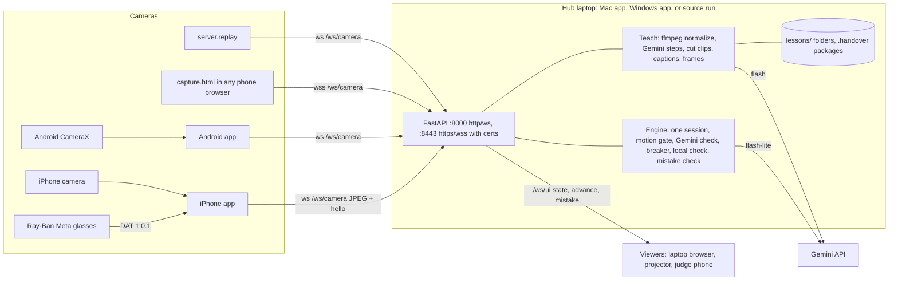

# HandOver build plan (Saturday 2026-11-14 afternoon to Sunday noon)

Owner: lead. Read-only for both developers. The wire contract is [CONTRACT_V2.md](CONTRACT_V2.md). The architecture is [research/architecture.md](research/architecture.md). Where they disagree with older docs, those two win. [ARCHITECTURE.md](ARCHITECTURE.md) is an older draft and is superseded. The full idea list with a status for each idea is [IDEAS.md](IDEAS.md).

Hacking ends **12:00 PM Sunday 2026-11-15**. Judging is **1:00 to 2:30 PM**. Every hour figure below is an estimate for one developer driving an AI coding agent ("est. h"). None of them is measured.

## Lead decisions applied here

| Topic | Decision | Why |
|---|---|---|
| Glasses go/no-go | **8:00 PM Saturday** | Lead call. The 9 PM in research/scope.md is dropped |
| Android app | Owned by **Developer 2** (id W11, was M13) | Lead call: Android moved to Developer 2 to balance hours (Dev 1 was about 23 est. h, Dev 2 about 15). Matches the Dev 2 row in architecture.md section 13 |
| Feature freeze | **8:00 AM Sunday** | Lead call. SCOPE.md's 1:30 AM is too early for two people |
| Export and import (was M10) | SHOULD (S-P), first in line for Dev 1 after MUST | Dev 1's MUST list comes first. Until it lands, the Windows CI smoke test uses the committed `lessons/demo-v1` instead of an imported package |
| Replay "hotkey" | A script (`scripts/demo_replay.sh`, Dev 1) plus a "Recording" banner on screen (Dev 2) | A browser key cannot start a process on the hub. One terminal command is as fast in practice |
| Competitors named on stage | Retrocausal and Dozuki only (pages fetched in market.md) | DeepSight is search-only in market.md. Both scope docs forbid unsourced names |
| Gemini latency gate | Pass at median 2.0 s or less. 2.0 to 2.5 s: wider motion gate. Over 2.5 s: one confident yes plus local agreement | Merges SCOPE.md and research/scope.md |
| mDNS | STRETCH | Both scope docs cut it. QR plus a typed address cover every case |

## 1. Thesis, hook, differentiation

- **Thesis:** an expert does the task once on camera while narrating. HandOver cuts that take into steps and plays the expert's own clip for each step. It moves on only when the learner's camera shows the step is done.
- **Hook:** "Experts teach the same task over and over. With HandOver they do it once, and the lesson watches the next person." Then the judge skips the flip, and the screen says so.
- **Honest differentiation:**
  - Dozuki and VSight turn video into documents or timestamped steps. Neither plays the expert's clip gated by a live camera check.
  - Retrocausal tracks steps live, but needs a fixed station camera, captured cycles and a labeling pass.
  - HandOver: one narrated take, no labeling, no headset required, any phone with any laptop on the same network.
- **Never say:** "first", "only", any training-time saving, any user count. Say "one take" only if the bike lesson really was one take.

## 2. Red team: top attacks and our answer

| # | Attack | Answer in this plan |
|---|---|---|
| S1 | Too many platforms for 2 devs | One hub, one web UI. Native apps are thin camera clients on one contract. Claim only pairs we tested; the matrix in section 7 labels each pair live, CI, emulator or untested |
| S2 | Venue Wi-Fi blocks devices from reaching each other | Our own phone hotspot plus a backup hotspot. Camera status shown big. Replay one command away. cloudflared tunnel as last resort for browser capture |
| S3 | iOS blocks ws:// and local network | Plist keys `NSAllowsLocalNetworking`, `NSLocalNetworkUsageDescription`, `NSBonjourServices`; idle timer off; glasses gate at 8 PM; pitch "works with any phone, glasses optional" |
| S4 | Gemini limits, outage, latency | Motion gate, 3 s timeout, circuit breaker, local OpenCV check with an "Offline check" badge, latency on screen, separate rehearsal and demo projects |
| S5 | Check passes look fake or are wrong | Step 1 manual. Reference = stillest hands-free frame in the last 15% of the clip. Questions by shape and seam count, not color. Planted flip rehearsed 20 times, need 18 |
| S6 | "This is a video player with a timer" | `reason` in the badge, the mistake banner that names the missed step, the bike lesson made from one take shown next to its lesson.json |
| S7 | Judge too fast or too slow | Jump ahead (confirmed by one check of the next step). Next always works. Chest or stand mount over glasses for judges |
| S8 | Loud hall breaks voice | Captions are primary. Voice "next" off by default. Next button and keyboard always work |
| S9 | Hall lighting | Desk lamp, black foam board, matte duo-color paper. 8 AM rehearsal under venue light |
| S10 | Privacy | Learn frames are checked, then discarded, never written to disk (a test asserts it). Recording dot on every camera client. One slide says what goes to Gemini |
| S11 | Small technical holes (ffmpeg on Windows, model ids, one learner per hub, teaching live) | ffmpeg bundled and looked up by path rules; model ids benchmarked at 6 PM; never claim multi-learner; never teach live over venue Wi-Fi |

## 3. Features

Platforms key: Hub = Mac and Windows hub; Web = every browser; iOS; Android; CI.

### MUST, Developer 1 (about 19 est. h)

| ID | Feature | Est. h | Platforms | Attack |
|---|---|---|---|---|
| M1 | Real Gemini check: confirm model ids, `python -m server.check --time` 20 calls on the hotspot, read project limits | 0.5 | Hub | S4, S11 |
| M2 | Frozen-app fixes: `server/paths.py` (data dir, ffmpeg and ffprobe lookup, web dist), serve the web dist at `/`, recut keeps unknown fields, `start_hub()` and `stop_hub()` | 1.5 | Hub | S11 |
| M3 | `/api/info`, `/api/qr`, `/join` route, `hub.json`, LAN address order, plus `scripts/smoke.py` (contract check and `watch` mode that prints every `state`, `advance`, `mistake`) | 1.5 | Hub | S1, S2 |
| M4 | Camera `hello` and `welcome`, active camera rule, `state.camera` and `state.cameras`, camera socket receives `state` and accepts `next` and `back` | 1.5 | Hub | S1 |
| M5 | Motion gate with 6 s heartbeat; latency already in `last_check` | 1 | Hub | S4, S7 |
| M6 | Circuit breaker, `HANDOVER_CHECK` modes, `check_source` and `check_offline` state, `last_check.reason` | 1 | Hub | S4, S6 |
| M7 | Local OpenCV check (`server/local_check.py`), veto rule while Gemini is up | 2.5 | Hub | S2, S4 |
| M8 | Clean reference frames (`ref_time`, stillest frame in the last 15%), step 1 manual, questions by shape and seams | 1 | Hub | S5 |
| M9 | Mistake check: behind and ahead, confirm before jumping, `common_mistake`, `dismiss_mistake` | 2.5 | Hub | S5, S6, S7 |
| M11 | Launcher with Tk window (name, URL, QR, Open, Quit), `--headless`, PyInstaller onedir Mac `.app` with bundled ffmpeg | 2.5 | Mac | S11 |
| M12 | CI: `.github/workflows/build.yml` (web, hub-test, hub-mac, hub-win, android, ios), Windows `.exe` built and smoke tested headless | 2.5 | CI, Windows | S1, S11 |
| M14 | Two real lessons cut (fortune teller, bike), two replay recordings filed, `scripts/demo_replay.sh` | 1 | Hub | S2, S5, S11 |
| M15 | Privacy backed by code: a test asserts learn frames never touch disk | 0.25 | Hub | S10 |

With Android moved to Developer 2, this fits one agent session; Dev 1 does not need two parallel sessions. The freed time goes to M12 and S-P earlier. **Drop order if behind at midnight:** M7 shrinks to "breaker shows Checks off, use Next"; then hub-win stays "build only"; then S-P waits until after Sync 7.

### MUST, Developer 2 (about 19 est. h)

| ID | Feature | Est. h | Platforms | Attack |
|---|---|---|---|---|
| W1 | Web works when served by the hub at `http://<ip>:8000/` (relative URLs, no Vite proxy needed); `web/mock/mock-server.mjs` mirrors CONTRACT_V2 | 1 | Web | S1 |
| W2 | Connect panel: QR from `/api/qr`, address in text, "Wrong network?" picker over `urls.lan`, camera name in the top bar | 1.5 | Web | S1, S2 |
| W3 | `server/static/join.html`: "Open in HandOver app" and, when HTTPS exists, "Use this browser" | 0.5 | Web | S1 |
| W4 | `capture.html`: `hello`, recording dot, idle notice on `camera_status`, no reconnect on close code 4000 | 0.75 | Web | S2, S10 |
| W5 | Honest live states: camera lost (last frame dimmed), "Offline check" badge, check source and latency in small text, "Recording" banner when `camera.source == "file"`, `reason` shown at confidence 0.7 or more, privacy line | 1.5 | Web | S2, S4, S6, S10 |
| W6 | Mistake banner: amber, spoken with `speechSynthesis`, "You're ahead", buttons "Show step n" (goto) and "I'm fine" (`dismiss_mistake`) | 1.5 | Web | S5, S6, S7 |
| W7 | Spectator view: read-only mirror of the learn screen on a phone browser | 1 | Web | S1 |
| W8 | iPhone app: SwiftUI, xcodegen, AVCapture 1 fps JPEG, `hello`, step title, Next and Back, haptics (verified, mistake), screen awake, `handover://connect` and typed address, plist keys, `apps/ios/ci.sh` | 5 | iOS | S1, S3 |
| W9 | App icon in `assets/icon/` (SVG plus PNGs) | 0.5 | All | |
| W10 | Submission: `docs/TESTED.md` (matrix results), `docs/DEVPOST.md`, one slide with the tested matrix, real screenshots | 2 | | S1 |
| W11 | Android app (was M13): Kotlin, CameraX 1 fps JPEG over OkHttp, `hello`, step title, Next and Back, haptics, `handover://connect` and typed address, cleartext config, `apps/android/ci.sh` | 4 | Android | S1 |

**Dev 2 drop order if behind at midnight:** W11 becomes "APK built in CI, emulator only"; then W7 waits; then W9 uses a plain placeholder mark.

### SHOULD (only after every MUST passes its gate)

| ID | Feature | Owner | Est. h | Platforms |
|---|---|---|---|---|
| S-G | Ray-Ban Meta source in the iPhone app (DAT 1.0.1), auto fallback to the phone camera. **Time-boxed 6:30 to 8:00 PM; 8 PM gate decides** | Dev 2 | 3 | iOS |
| S-D | Done screen: your time vs the expert's per step, steps checked by camera, mistakes caught, all from real events | Dev 2 | 2 | Web |
| S-P | `.handover` export and import endpoints, Windows CI smoke imports a Mac-made package | Dev 1 | 1.5 | Hub, CI |
| S-PB | Export and import buttons in the lesson list | Dev 2 | 0.5 | Web |
| S-T | Check self-test at teach time (own frame yes, previous frame no), green or amber per step | Dev 1 (1.5), Dev 2 badge (0.5) | 2 | Hub, Web |
| S-A | Keyboard (Space, arrows, R, C, F), `aria-live` step announcements, reduced motion, caption size | Dev 2 | 1.5 | Web |
| S-W | "Why" (narration around the step) and slow replay | Dev 2 | 1 | Web |
| S-F | Target frame toggle and confidence ring | Dev 2 | 1 | Web |
| S-K | `PUT /api/settings` (Gemini key) and a key field in the web app | Dev 1 (0.5), Dev 2 (1) | 1.5 | Hub, Web |
| S-S | Safety warnings and tools list from the narration (bike) | Dev 1 (1), Dev 2 (1) | 2 | Hub, Web |
| S-Q | In-app QR scanner: iOS (1 h) and Android (1 h) | Dev 2 | 2 | iOS, Android |
| S-I | `.dmg` (Dev 1, 0.5 h) and Inno Setup installer with firewall rule (Dev 1, 1 h) | Dev 1 | 1.5 | Mac, Windows |

### STRETCH

| Feature | Owner | Est. h |
|---|---|---|
| Glasses source in the Android app (needs a real Android phone and the glasses) | Dev 2 | 4 |
| Filmstrip of the learner's verified frames on the Done screen | Dev 2 | 1.5 |
| Translated caption tracks (hub job plus picker) | Dev 1 (2), Dev 2 (1) | 3 |
| Review editor: rename and drag boundaries | Dev 2 | 5 |
| `/record` page and multi-file teach upload | Dev 2 (1.5), Dev 1 (0.5) | 2 |
| Printable one-page guide | Dev 2 | 2 |
| mDNS advertise and browse | Dev 1 hub, Dev 2 iOS and Android | 2.5 |
| Playwright on windows-latest loading the hub and playing a clip | Dev 1 | 1 |

### CUT

Hand ghost, multiple learners, Gemini Live API, ask-the-expert chat, voice cloning, accounts, cloud deploy, offline service worker, Tauri or Electron, Mica and native window chrome, pairing code, re-record one step, paid code signing, gemini-3.1-pro-preview (no free tier), teaching live at the venue, naming DeepSight, any "first" claim or savings number. Voice "next" stays built but off by default.

## 4. Architecture

1. One Python FastAPI hub is the only server and the only stateful node. It runs on the laptop.
2. The web app (Vite, React) is the only learn and teach UI; the hub serves it at `/`.
3. Cameras only send JPEGs to `/ws/camera`, about 1 fps, with an optional `hello` first.
4. Viewers join `/ws/ui`; every viewer gets the same `state`, `advance` and `mistake` messages.
5. One learner per hub. The newest active camera wins; other cameras stay idle.
6. Check order: motion gate, Gemini flash-lite (3 s timeout), debounce, then advance. Breaker falls back to the local OpenCV check.
7. Mistake check runs after 5 s of settled "no" and compares steps k-1, k and k+1.
8. Pairing is a QR of `http://<ip>:8000/join?hub=<id>`; join.html hands off to the app or to the HTTPS capture page.
9. A lesson is a folder with relative paths; a `.handover` zip moves it between hubs on any OS.
10. Desktop apps are the frozen hub (PyInstaller onedir) plus a Tk window and the system browser. No webview.

Details: [research/architecture.md](research/architecture.md). Every message, field and error string: [CONTRACT_V2.md](CONTRACT_V2.md).

## 5. Ownership

Every path has exactly one owner. Nobody edits a file they do not own; ask the owner in one message with the exact change.

| Path | Owner | Notes |
|---|---|---|
| `server/main.py`, `check.py`, `teach.py`, `replay.py`, `__init__.py` | Dev 1 | EXISTS |
| `server/test_check.py`, `server/test_server.py`, `server/tests/**` | Dev 1 | plain-assert tests |
| `server/paths.py`, `discovery.py`, `package.py`, `gate.py`, `local_check.py`, `mistake.py`, `launcher.py`, `translate.py` | Dev 1 | NEW |
| `server/requirements.txt`, `server/requirements.lock` | Dev 1 | adds segno, opencv-python-headless, numpy; pyinstaller build only |
| `server/static/**` (`capture.html`, `join.html`) | Dev 2 | Dev 1 only serves these files |
| `server/uploads/` | nobody | runtime output, gitignored |
| `scripts/**` (`certs.sh`, `run_server.sh`, `make_demo_lesson.sh`, `smoke.py`, `demo_replay.sh`) | Dev 1 | |
| `packaging/**` (PyInstaller spec, Mac dmg script, Inno Setup, ffmpeg fetchers, licenses) | Dev 1 | |
| `.github/workflows/**` | Dev 1 | calls `apps/*/ci.sh` and `npm` scripts, never edits them |
| `lessons/**` | Dev 1 | sample and demo lessons |
| `recordings/` (replay MP4s, gitignored) | Dev 1 | humans record, Dev 1 files and names them |
| `apps/android/**` including `apps/android/ci.sh` | Dev 2 | lead decision: moved from Dev 1 to balance hours. The `android` CI job stays in Dev 1's workflow and only calls `apps/android/ci.sh` |
| `apps/ios/**` including `apps/ios/ci.sh` | Dev 2 | |
| `web/**` (src, mock, e2e, screenshots, package files, vite and ts config, `web/.gitignore`) | Dev 2 | learn, teach, connect and QR, join flow, spectator, mistake banner, offline badge, done screen |
| `assets/icon/**` | Dev 2 | Dev 1 reads it for app and installer icons |
| `docs/TESTED.md`, `docs/DEVPOST.md`, `docs/pitch/**` | Dev 2 | Dev 1 sends result rows by message |
| `docs/CONTRACT_V2.md` | Dev 1 | shared, change process below |
| `README.md`, `.gitignore` | Dev 1 | shared, change process below |
| `CONTRACT.md` | Dev 1 | add "Superseded by docs/CONTRACT_V2.md" at the top |
| `docs/PLAN.md`, `docs/IDEAS.md`, `docs/SPEC.md`, `docs/SCOPE.md`, `docs/ARCHITECTURE.md`, `docs/RESEARCH_GLASSES_GEMINI.md`, `docs/research/**` | lead | read-only for both devs |
| `.env`, `certs/`, `.venv/`, `node_modules/`, `web/dist/`, `build/`, `dist/` | nobody | local or generated, never committed |

**Change process for shared files** (`docs/CONTRACT_V2.md`, `README.md`, `.gitignore`):
1. Dev 2 sends Dev 1 one message with the exact text (field, type, which side sends it).
2. Dev 1 edits, bumps the `Revision` line of CONTRACT_V2, commits, and replies with the commit hash.
3. Additive optional changes: Dev 1 decides alone. Renames, removals or type changes need both humans and land with the hub and client change in the same hour.
4. **6:00 AM contract freeze.** After that, bug fixes only, both humans agree.
5. A new top-level path needs the lead's OK and a row in this table first.

**Branches:** each developer works in their own git worktree and branch (`dev1/*`, `dev2/*`). Merge to `main` only after `.venv/bin/python -m server.test_server`, `.venv/bin/python -m server.test_check` and `npm --prefix web run build` pass.

## 6. Timeline

Before any heavy step (PyInstaller, Gradle, Xcode build, full tests), check the Mac load with the rule in the user's settings and wait if high. At most one simulator or emulator at a time.

### Per developer

| Time | Developer 1 (hub, packaging, CI) | Developer 2 (web, iOS, Android, capture, join) |
|---|---|---|
| Sat 2:30 to 3:00 PM | Worktree, branch; humans create the GitHub repo and add keys | Worktree, branch; `xcodegen` project skeleton for `apps/ios`; `apps/android` Gradle skeleton once the SDK is confirmed |
| 3:00 to 4:30 PM | M2, M3 (with `scripts/smoke.py`), M4 | W8 phone camera streaming plain JPEGs (works against today's hub); W1 |
| **4:30 PM** | **Sync 1: contract smoke test** | |
| 4:30 to 6:30 PM | M1 (gate at 6 PM), M5, M6 | W8 `hello`, state, Next, haptics on the real iPhone; W4; W2 |
| **6:30 PM** | **Sync 2: first live loop with the iPhone app** | |
| 6:30 to 8:00 PM | M8, M9; cut the fortune teller take when recorded (M14) | S-G glasses source, time-boxed |
| **8:00 PM** | **Sync 3: glasses gate** | |
| 8:00 to 10:00 PM | M7; M11 Mac `.app` | W5, W6, W3 |
| **10:00 PM** | **Sync 4: Mac app checkpoint** | |
| 10:00 PM to 12:00 AM | M15; cut the bike take (M14); start M12 CI workflows | W11 Android on a phone or emulator; W7, W9 |
| **Sun 12:00 AM** | **Sync 5: midnight full run** | |
| 12:00 to 2:00 AM | M12 CI workflows, hub-win smoke; then S-P export and import | Fix bugs from Sync 5; S-A; Dev 2 sleeps 12:30 to 5:30 AM |
| **2:00 AM** | **Sync 6: CI green gate** (Dev 1 alone, reports to Dev 2 in writing) | |
| 2:00 to 6:00 AM | Dev 1 sleeps 2:30 to 6:00 AM | 5:30 AM: S-D done screen, S-W, S-F, screenshots for W10 |
| **6:00 AM** | **Sync 7: contract freeze** | |
| 6:00 to 8:00 AM | S-P if not done, S-T self-test, bug fixes | S-PB, S-T badge, matrix tests on every device (W10) |
| **8:00 AM** | **Sync 8: feature freeze and venue-light rehearsal** | |
| 8:00 to 10:00 AM | Bug fixes only; Windows verification; S-I if green | Bug fixes only; Android verification; `docs/TESTED.md`; Devpost draft |
| **10:00 AM** | **Sync 9: Devpost draft** | |
| 10:00 to 10:30 AM | Code freeze 10:30, tag, release | Backup demo video recorded |
| **11:30 AM** | **Sync 10: submit** | |
| 12:00 to 1:00 PM | Setup at the table, three run-throughs | same |
| 1:00 to 2:30 PM | Judging | Judging |

### Sync points (each one is pass or fail)

Hub under test, unless a row says otherwise: `HANDOVER_CHECK=mock HANDOVER_MOCK_PASS_SECONDS=3 .venv/bin/python -m server.main`.

| When | Sync | Pass test | Command | On fail |
|---|---|---|---|---|
| Sat 4:30 PM | 1. Contract smoke | `/api/info` returns `contract: 2`; replay sends `hello`; `state.camera.name` is `Replay: norm.mp4`; an `advance` with reason `camera` arrives; web builds and its real-hub check passes | `.venv/bin/python scripts/smoke.py --base http://localhost:8000` then `.venv/bin/python -m server.test_server && .venv/bin/python -m server.test_check` then `cd web && npm run build && node e2e/real-server.mjs` | Dev 1 fixes the hub before anything else; Dev 2 keeps working against `web/mock` |
| Sat 6:00 PM | Gemini gate (inside Dev 1's block) | 20 real calls, median 2.0 s or less, limits written down | `.venv/bin/python -m server.check --time lessons/demo-v1/frames/02.jpg lessons/demo-v1/frames/02.jpg "Is this step finished?" -n 20` | 2.0 to 2.5 s: wider gate; over 2.5 s: one yes plus local agreement |
| Sat 6:30 PM | 2. First live loop, iPhone app | Real iPhone on the hotspot, typed address; `watch` shows `camera.platform: "ios"`, one `advance` reason `camera`, and Next on the phone gives an `advance` reason `button` on every screen | `.venv/bin/python scripts/smoke.py watch --base http://<hub ip>:8000` | Dev 2 switches to capture.html for later syncs while fixing the app |
| Sat 8:00 PM | 3. Glasses gate | Glasses frames reach the hub through the iPhone app for 60 s without a gap over 5 s; `camera.source: "glasses"`; one camera advance on the demo lesson | same `watch` command | Glasses leave the demo, the pitch and the Devpost. Code stays behind the source toggle, never claimed |
| Sat 10:00 PM | 4. Mac app | Frozen `.app` starts headless and passes smoke | `dist/HandOver.app/Contents/MacOS/HandOver --headless &` then `.venv/bin/python scripts/smoke.py --base http://localhost:8000` | Mac: demo runs from source |
| Sun 12:00 AM | 5. Midnight full run | Android app (Dev 2, phone or emulator) shows `camera.platform: "android"` in `watch`; real Gemini, iPhone app, fortune teller lesson folded to done; planted skipped flip gives a `mistake` with `kind: "behind"`; with Wi-Fi off, `check_offline: true` and the lesson still finishes (local check or Next); clean replay in local mode reaches done | `.venv/bin/python scripts/smoke.py watch` during the fold; then `HANDOVER_CHECK=local .venv/bin/python -m server.main` and `scripts/demo_replay.sh recordings/fold-clean.mp4` | Stop all SHOULD work; both devs fix the loop. Android: APK from CI only, labeled |
| Sun 2:00 AM | 6. CI green | Latest `main` run green on web, hub-test, hub-mac, hub-win, android, ios | `gh run list --branch main --limit 1` then `gh run view <id> --json jobs --jq '.jobs[] \| [.name, .conclusion]'` | A red platform is dropped from the claim; hub-win red means "Windows: not shipped" |
| Sun 6:00 AM | 7. Contract freeze | Smoke passes against the source hub and the CI Mac artifact; tag set; no later change to the contract file | `git tag contract-freeze`; later `git diff contract-freeze -- docs/CONTRACT_V2.md` must print nothing | Both humans approve any bug fix |
| Sun 8:00 AM | 8. Feature freeze, rehearsal | Under venue light: planted flip caught 18 of 20 or more; full fold finishes in every try | `.venv/bin/python scripts/smoke.py watch \| tee rehearsal.log` then `grep -c '"kind": "behind"' rehearsal.log` | Step 5 becomes manual and the demo plants a mistake that is caught reliably |
| Sun 10:00 AM | 9. Devpost draft | Every device claim maps to a live or CI row in `docs/TESTED.md`; real screenshots; no dashes; no banned claims | `perl -CSD -ne 'print "$.: $_" if /[\x{2013}\x{2014}]/' docs/DEVPOST.md` and `grep -niwE 'first\|only' docs/DEVPOST.md` both print nothing | Fix copy before 10:30 |
| Sun 10:30 AM | Code freeze, release | Tag pushed; release has the dmg or zipped `.app`, the Windows build, the APK | `git tag v0.2.0 && git push origin v0.2.0` then `gh release view v0.2.0 --json assets --jq '.assets[].name'` | Release whatever is green, list the rest as not shipped |
| Sun 11:30 AM | 10. Submit | Devpost shows submitted; video and repo links open in a private window | manual check in a private browser window | Submit with what exists; never miss noon |

## 7. Cross-OS interoperability matrix

Labels: **live** = run by hand on real hardware; **CI** = automated on a GitHub runner; **emulator**; **untested**. Only live and CI pairs go on the slide. Results are recorded in `docs/TESTED.md` (Dev 2).

### Cameras to hubs

| Camera | Mac app (frozen) | Windows app (frozen) | Source run on Mac |
|---|---|---|---|
| iPhone app, phone camera | live (Dev 2, after Sync 4) | untested unless a Windows laptop exists; then live (Dev 1) | live (Dev 2, Sync 2) |
| iPhone app, glasses | live only if the 8 PM gate passes (Dev 2) | untested | live at Sync 3 (Dev 2) |
| Android app, phone camera | live with a real phone, else emulator (Dev 2) | untested unless a Windows laptop exists (Dev 2) | live or emulator (Dev 2, Sync 5) |
| Android app, glasses | untested (STRETCH) | untested | untested (STRETCH) |
| iPhone Safari, capture.html | live only if mkcert certs are copied to the app data dir (Dev 2) | untested | live with mkcert root trusted on the phone (Dev 2) |
| Android Chrome, capture.html | live through a cloudflared tunnel if a phone exists (Dev 2) | untested | live through a tunnel if a phone exists, else untested (Dev 2) |
| Replay (`server.replay`) | CI (hub-mac smoke) and live (Dev 1) | CI (hub-win smoke, Dev 1) | live and CI on Linux (hub-test, Dev 1) |

### Viewers (learn screen, spectator, teach)

| Browser | Mac | Windows | Phones |
|---|---|---|---|
| Chrome | live and Playwright (Dev 2) | untested unless a Windows laptop exists; STRETCH: Playwright on windows-latest (Dev 1) | Android Chrome: live with a real phone, else emulator (Dev 2) |
| Edge | live if installed, else "Chromium via Playwright", labeled (Dev 2) | untested unless a Windows laptop exists (Dev 2 tests on it) | not targeted |
| Safari | live (Dev 2) | not available | iPhone Safari: live (Dev 2) |
| Firefox (no voice) | live (Dev 2) | untested | not targeted |

### Lessons across hubs

| From to | How verified |
|---|---|
| Mac-made lesson on the Windows hub | CI (hub-win imports a `.handover` made in hub-mac) once S-P lands, else untested |
| Mac-made lesson on another Mac | live (Dev 1) once S-P lands |

## 8. Demo script (4 minutes)

| Time | Beat | What is on screen | Fallback |
|---|---|---|---|
| 0:00 to 0:20 | Hook | Learn screen idle with the QR. "Experts teach the same task over and over. With HandOver they do it once, and the lesson watches the next person." | None needed |
| 0:20 to 0:55 | Teach | Bike lesson made from one take: timeline, clip thumbnails, lesson.json beside it. Click a clip, it plays in the expert's voice with captions | Everything is pre-cut on disk; no network needed. If the browser misbehaves, reload; last resort is the backup video of this beat, said out loud |
| 0:55 to 2:10 | Judge folds | Black board, desk lamp, iPhone app on a stand (glasses only if Sync 3 passed). Clips advance as each fold is seen; chime on each camera advance | Ladder: glasses, then iPhone app (swap under 10 s), then capture.html, then `scripts/demo_replay.sh` with the "Recording" banner. Gemini down: "Offline check" badge appears on its own. Any misfire: "Next always works" |
| 2:10 to 2:40 | The catch | Judge skips the flip on purpose. Amber banner and voice: "Still step 4: flip it over." Judge fixes it, lesson continues | Not caught within 10 s: say so, press Next, and play the skipped-flip recording labeled "Recording" |
| 2:40 to 3:00 | Done | Finished fortune teller on the table; Done screen with real times if S-D shipped | Skip to the next beat |
| 3:00 to 3:30 | Every OS | Android phone scans the QR and takes over as the camera; a judge's phone opens the spectator view; Next on one phone moves every screen. Then the CI page: Mac, Windows, iOS, Android builds green | No Android phone: the judge's own phone joins as spectator. Windows is only ever shown as the CI run unless tested by hand |
| 3:30 to 3:50 | Why it is different | "Dozuki and VSight make documents. Retrocausal needs a station camera and labeled cycles. HandOver needs one take and any phone." | None |
| 3:50 to 4:00 | Close | "Frames are checked, then discarded." Repeat the hook line | None |

## 9. Risks and mitigations

| Risk | Mitigation | Owner |
|---|---|---|
| Either developer falls behind | Android moved to Dev 2 to balance hours; drop orders for both in section 3; Dev 2 runs device testing | both |
| Android SDK not on the Mac | Ask the humans before the large install; CI builds the APK regardless; emulator is the fallback, labeled | Dev 2 |
| No Windows machine | Windows ships as "built and smoke tested in CI, not tested by hand" | Dev 1 |
| Glasses stream fails | 8 PM gate; phone camera is the main path in the pitch | Dev 2 |
| Free-tier limits hit during rehearsal | Motion gate; rehearsal project key separate from demo key; local check | Dev 1, humans |
| Check misfires under hall light | Lamp, foam board, matte paper; step 1 manual; 8 AM rehearsal count | both |
| Planted flip not caught reliably | Count at 8 AM; if under 18 of 20, step 5 manual and a different plant | Dev 1 |
| Hotspot drops or blocks devices | Second hotspot ready; replay; localhost-only mode with a USB camera | humans |
| iOS refuses ws to a raw IP | `NSAllowsLocalNetworking`; if still refused, `NSAllowsArbitraryLoads` for this build | Dev 2 |
| PyInstaller misses a lazy import or tkinter | Headless smoke in CI; source run on Mac is the demo fallback | Dev 1 |
| macOS blocks the unsigned app | System Settings, Privacy and Security, Open Anyway; or `xattr -dr com.apple.quarantine` | Dev 1 |
| Contract drift between hub and clients | Contract freeze at 6 AM; smoke tests at every sync; mock mirrors V2 | both |
| Mac overheats or loads up | Load check before heavy steps; one emulator or simulator at a time | both |
| Running out of time for Devpost | Draft at 10 AM, submit 11:30 AM, not noon | Dev 2 |

## 10. Humans-only checklist

- [ ] Create two Google Cloud projects and one Gemini key in each (rehearsal and demo). Put the demo key in `.env`. Read limits on the AI Studio rate-limit page. Do not enable billing.
- [ ] Create the GitHub repo and decide public or private (public keeps Mac and Windows CI minutes free). Push `main`.
- [ ] Confirm prize tracks and Devpost deadline on the MadHacks Discord.
- [ ] Meta AI app: Developer Mode on, glasses updated, charged and paired, before 6:30 PM.
- [ ] iPhone: allow free Apple ID signing (trust the developer profile), trust the mkcert root, turn off auto-lock for the demo.
- [ ] Android phone with USB debugging on, if anyone has one. Say yes or no by 6 PM.
- [ ] A Windows laptop, if anyone has one. Say yes or no by 6 PM.
- [ ] OK the Android command line tools and an emulator image install on the Mac (large download), or decline.
- [ ] Buy or bring: 10 or more duo-color kami sheets (20 to 25 cm, matte), pre-folded examples, paper cups, black foam board or felt, desk lamp, phone stand or chest mount, earbuds, chargers, power strip.
- [ ] Record takes: bike (one take, narrated), fortune teller (narrated), a clean fold replay, a skipped-flip replay. Hand the files to Dev 1.
- [ ] Set up both hotspots and test every demo device on them.
- [ ] 8 AM rehearsal under venue light; count the planted flip catches.
- [ ] Record the backup demo video.
- [ ] Submit the Devpost by 11:30 AM. Pitch, and ask a judge to fold.
