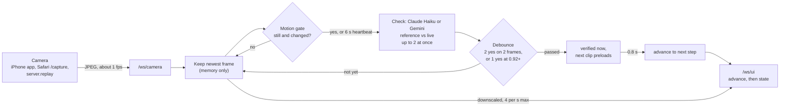

# HandOver hub (server/)

The hub is one Python process on the Mac. It turns an expert video into a lesson of step clips, then watches a learner's camera and moves to the next clip when the step looks done.

Wire formats live in [CONTRACT.md](../CONTRACT.md); fields this lane proposes are in [docs/contract-proposals.md](docs/contract-proposals.md). Status words used on these pages:

| Word | Meaning |
|---|---|
| Live | In the code the hub runs today, with tests |
| In progress | Being built now, not in the hub yet |

## Quick start (Mac)

Run from the repo root.

```sh
uv venv --python 3.12 .venv
uv pip install --python .venv/bin/python -r server/requirements.lock
cp .env.example .env                      # then add ANTHROPIC_API_KEY or GEMINI_API_KEY
scripts/certs.sh                          # once; HTTPS so iPhone Safari can use the camera
scripts/run_server.sh                     # http :8000, https :8443 when certs exist
```

No key, or working offline:

```sh
HANDOVER_CHECK=mock scripts/run_server.sh       # each camera step passes after 6 s on it
scripts/make_demo_lesson.sh                     # builds lessons/demo-v1, a test pattern, without a model
```

`lessons/demo-v1` is a synthetic test pattern (colored bars), not a real lesson. Its title says so.

Feed a recording in as the camera:

```sh
.venv/bin/python -m server.replay recordings/fold.mp4 --select fortune-teller-v1
```

## Providers

| Item | Behavior |
|---|---|
| Live check provider | `HANDOVER_CHECK_PROVIDER=auto` (default) picks Claude Haiku when `ANTHROPIC_API_KEY` is found (environment or `<repo>/.env`), else Gemini. `claude` or `gemini` pins one |
| Which one ran | `state.check_mode` is `mock`, `claude` or `gemini`; check events carry the real model id; mistakes carry `source` `mock`, `claude` or `gemini` |
| Claude budget | Hard caps: $20 per local day (`HANDOVER_CLAUDE_BUDGET_DAY_USD`) and $50 in total (`HANDOVER_CLAUDE_BUDGET_TOTAL_USD`). At a cap no call is made and the UI shows checks off with reason `budget` |
| Spend so far | `.venv/bin/python -m server.spend` prints today, the total, both caps and what is left |
| Tests | `HANDOVER_NO_NETWORK=1` never builds a real model client, so a key in `.env` cannot turn a test into a paid call. The contract suite and the e2e demo also start their hub without keys or Databricks settings and with a temp event file |

## Live loop



## Modules

| File | Job | Status |
|---|---|---|
| `main.py` | REST, lesson files, `/ws/camera`, `/ws/ui`, learn engine, http and https in one process | Live |
| `check.py` | Two-image check (Claude Haiku or Gemini), mock mode, breaker, debouncer, `--time` tool | Live |
| `gate.py` | Motion gate: which frames are worth a check | Live |
| `mistake.py` | When to run the k-1, k, k+1 compare and what message to send | Live |
| `spend.py` | Claude spend ledger and budget caps | Live |
| `teach.py` | Normalize, extract steps (Gemini, or Claude plus local Whisper narration), cut clips, captions, reference frames, self-test, recut | Live |
| `voice.py` | Voiceover for lessons | In progress (another agent) |
| `replay.py` | Stream an MP4 into `/ws/camera`, with hello | Live |
| `databricks.py` | Learn events to a local JSON lines mirror and, with credentials, to Databricks | Live |
| `static/capture.html` | Safari camera page | Live |

## Environment variables

The full registry with bounds is `python -m server.config`. The ones you are most likely to touch:

| Variable | Default | Meaning | Status |
|---|---|---|---|
| `HANDOVER_PORT`, `HANDOVER_HTTPS_PORT` | 8000, 8443 | ports; https only when certs exist | Live |
| `HANDOVER_LESSONS`, `HANDOVER_CERTS` | `<repo>/lessons`, `<repo>/certs` | folders | Live |
| `ANTHROPIC_API_KEY`, `GEMINI_API_KEY`, `GOOGLE_API_KEY` | none, then `<repo>/.env` | keys; never printed or returned | Live |
| `HANDOVER_CHECK` | `gemini` | `mock` = no network; anything else = a real provider | Live |
| `HANDOVER_CHECK_PROVIDER` | `auto` | `auto`, `claude` or `gemini` | Live |
| `HANDOVER_CHECK_MODEL`, `HANDOVER_CLAUDE_CHECK_MODEL` | `gemini-3.5-flash-lite`, `claude-haiku-5-5` | check model per provider | Live |
| `HANDOVER_CHECK_TIMEOUT` | 3 | seconds before a call counts as a timeout | Live |
| `HANDOVER_DEBOUNCE_N`, `HANDOVER_MIN_CONF` | 2, 0.8 | yes answers needed, lowest confidence that counts as yes | Live |
| `HANDOVER_MAX_INFLIGHT` | 2 (1 to 4) | checks at once on one step, each on a different settled frame | Live, registration in config.py pending |
| `HANDOVER_FAST_PATH`, `HANDOVER_FAST_CONF` | 1, 0.92 (0.5 to 1) | one yes at this confidence that names no difference advances alone | Live, registration in config.py pending |
| `HANDOVER_VERIFIED_HOLD` | 0.8 | seconds `verified` shows before the step moves | Live |
| `HANDOVER_AHEAD_SKIP` | 0 | 1 lets a confirmed "ahead" skip to step k+2; off, it only shows the banner | Live, registration in config.py pending |
| `HANDOVER_GATE`, `HANDOVER_GATE_CHANGE` | 1, 0.018 | motion gate on; change (1.8%) from the last checked frame that allows a new check | Live |
| `HANDOVER_BREAKER_SECONDS` | 30 | how long checks stay off after the breaker opens | Live |
| `HANDOVER_MOCK_PASS_SECONDS` | 6 | mock passes after this many seconds on a step | Live |
| `HANDOVER_MOCK_MISTAKE` | unset | test only: `behind:<step>` or `ahead:<step>`, 0-based | Live |
| `HANDOVER_NO_NETWORK` | 0 | tests: no real model client, no warm-up | Live |
| `HANDOVER_TEACH_PROVIDER`, `HANDOVER_TEACH_MOCK` | `auto`, unset | teach provider; `1` = placeholder steps, no model | Live |

## Tests

No pytest in the lock file, so each test file runs as a module. Set `HANDOVER_NO_NETWORK=1` so nothing reaches a model.

```sh
export HANDOVER_NO_NETWORK=1
.venv/bin/python -m server.test_engine     # engine, cameras, gate, breaker, mistakes, latency paths, M15 privacy
.venv/bin/python -m server.test_contract   # black-box CONTRACT.md suite against its own hub
.venv/bin/python -m server.test_server     # teach pipeline, recut, REST
.venv/bin/python -m server.test_check      # checks, breaker, debouncer, mock
.venv/bin/python -m server.test_teach      # extraction, transcripts, reference frames, self-test
.venv/bin/python -m server.test_config     # registry of HANDOVER_* settings
.venv/bin/python scripts/e2e_demo.py       # web build, hub, replay camera, Chrome
.venv/bin/python scripts/latency_bench.py  # settle-to-advance time with and without the confirm speedups
```

## Measured numbers

Only numbers someone measured, with how.

| Number | Value | How it was measured |
|---|---|---|
| One Claude Haiku check | p50 about 1.1 to 1.3 s | 5-call `server.check --time` runs against real frames |
| State broadcast to viewers | p50 11 ms | `scripts/soak.py` load test |
| Settle to advance, mock | see [docs/engine.md](docs/engine.md#latency) | `scripts/latency_bench.py`, stand-in check of fixed latency |

## Deeper pages

- [docs/engine.md](docs/engine.md): learn engine states, stale guard, rev, cameras, latency
- [docs/checks.md](docs/checks.md): motion gate, model call, debounce, breaker, mistake check
- [docs/teach.md](docs/teach.md): video in, lesson folder out, self-test, recut
- [docs/operations.md](docs/operations.md): demo-day runbook, privacy, troubleshooting
