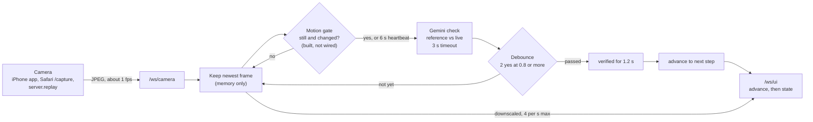

# HandOver hub (server/)

The hub is one Python process on the Mac. It turns an expert video into a lesson of step clips, then watches a learner's camera and moves to the next clip when the step looks done.

Wire formats live in [CONTRACT.md](../CONTRACT.md). This folder is Soham's lane. Status words used on these pages:

| Word | Meaning |
|---|---|
| Live | In the code the hub runs today |
| Built, not wired | The module and its tests exist, but `main.py` does not call it yet |
| In progress | Described in CONTRACT.md, no code yet |

## Quick start (Mac)

Run from the repo root.

```sh
uv venv --python 3.12 .venv
uv pip install --python .venv/bin/python -r server/requirements.lock
cp .env.example .env                      # then add GEMINI_API_KEY
scripts/certs.sh                          # once; HTTPS so iPhone Safari can use the camera
scripts/run_server.sh                     # http :8000, https :8443 when certs exist
```

No key, or working offline:

```sh
HANDOVER_CHECK=mock scripts/run_server.sh       # each camera step passes after 6 s on it
scripts/make_demo_lesson.sh                     # builds lessons/demo-v1 without Gemini
```

Feed a recording in as the camera:

```sh
.venv/bin/python -m server.replay recordings/fold.mp4 --select fortune-teller-v1
```

## Live loop



Today the gate box is skipped: every new frame goes straight to the check, one call in flight at a time.

## Modules

| File | Job | Status | Owner |
|---|---|---|---|
| `main.py` | REST, lesson files, `/ws/camera`, `/ws/ui`, learn engine, http and https in one process | Live | Soham |
| `check.py` | Gemini two-image check, mock mode, debouncer, `--time` tool | Live | Soham |
| `teach.py` | Normalize, one Gemini extraction, cut clips, captions, frames, recut | Live | Soham |
| `replay.py` | Stream an MP4 into `/ws/camera` | Live | Soham |
| `gate.py` | Motion gate: which frames are worth a check | Built, not wired | Soham |
| `mistake.py` | When to run the k-1, k, k+1 compare and what message to send | Built, not wired | Soham |
| `static/capture.html` | Safari camera page | Live | Pranav |

## Environment variables

From CONTRACT.md section 1, checked against the code.

| Variable | Default | Meaning | Status |
|---|---|---|---|
| `HANDOVER_PORT` | 8000 | http port | Live |
| `HANDOVER_HTTPS_PORT` | 8443 | https port, only when certs exist | Live |
| `HANDOVER_CERTS` | `<repo>/certs` | folder with `cert.pem`, `key.pem` | Live |
| `HANDOVER_LESSONS` | `<repo>/lessons` | lessons folder | Live |
| `GEMINI_API_KEY`, `GOOGLE_API_KEY` | none, then `<repo>/.env` | Gemini key; never printed or returned | Live |
| `HANDOVER_CHECK` | `gemini` | `mock` = no network; anything else = Gemini | Live |
| `HANDOVER_CHECK_MODEL` | `gemini-3.5-flash-lite` | check model | Live |
| `HANDOVER_MOCK_PASS_SECONDS` | 6 | mock passes after this many seconds on a step | Live |
| `HANDOVER_CHECK_TIMEOUT` | 3 | seconds before a call counts as unsure | Live |
| `HANDOVER_DEBOUNCE_N` | 2 | consecutive confident yes needed to advance | Live |
| `HANDOVER_MIN_CONF` | 0.8 | lowest confidence that counts as yes | Live |
| `HANDOVER_TEACH_MODEL` | `gemini-3.8-flash` | step extraction model | Live |
| `HANDOVER_TEACH_MOCK` | unset | `1` = no Gemini, three placeholder steps | Live |
| `HANDOVER_GATE` | 1 | `0` = no motion gate | Built, not wired |
| `HANDOVER_MISTAKE_MIN_CONF` | 0.7 | lowest compare confidence for a mistake. In `mistake.py`, not yet in CONTRACT.md | Built, not wired |
| `HANDOVER_MOCK_MISTAKE` | unset | test only: `behind:<step>` or `ahead:<step>`, 0-based | Built, not wired |
| `HANDOVER_BREAKER_SECONDS` | 30 | how long checks stay off after the breaker opens | In progress |

## Tests

No pytest in the lock file, so each test file runs as a module. No network needed.

```sh
.venv/bin/python -m server.test_check     # debouncer, mock check
.venv/bin/python -m server.test_server    # teach pipeline, recut, REST, engine (needs ffmpeg)
.venv/bin/python -m server.test_gate      # motion gate
.venv/bin/python -m server.test_mistake   # mistake policy
```

Time real Gemini checks (needs a key):

```sh
.venv/bin/python -m server.check --time REF.jpg LIVE.jpg "Is the paper folded in half?" -n 20
```

## Coming in this branch

| Item | Where it is described |
|---|---|
| Gate and mistake wired into the engine | [checks.md](docs/checks.md) |
| Breaker and `check_offline` in state | [checks.md](docs/checks.md) |
| Camera `hello`, active camera, `camera` in state | [engine.md](docs/engine.md) |
| Smoke and watch scripts (no files yet) | [operations.md](docs/operations.md) |
| Reference frame selection, step 1 manual, self-test | [teach.md](docs/teach.md) |
| Privacy test: learn frames never touch disk (M15) | [operations.md](docs/operations.md) |

## Deeper pages

- [docs/engine.md](docs/engine.md): learn engine states, stale guard, rev, timing
- [docs/checks.md](docs/checks.md): motion gate, Gemini call, debounce, breaker, mistake check
- [docs/teach.md](docs/teach.md): video in, lesson folder out, recut
- [docs/operations.md](docs/operations.md): demo-day runbook and troubleshooting
