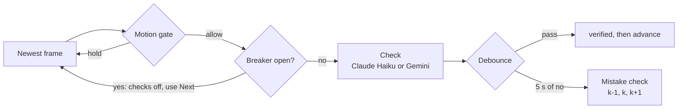
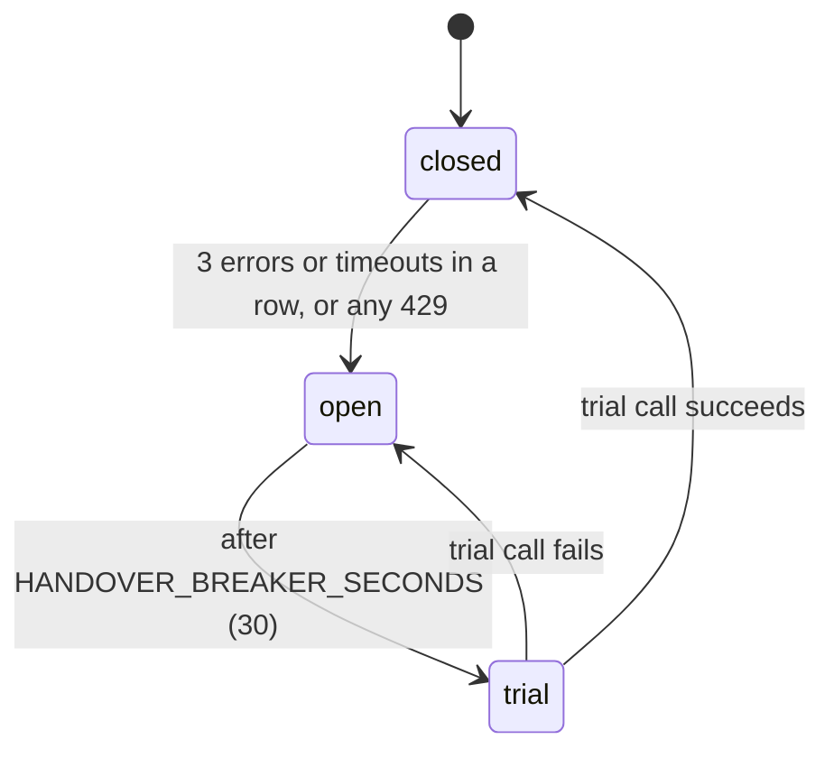
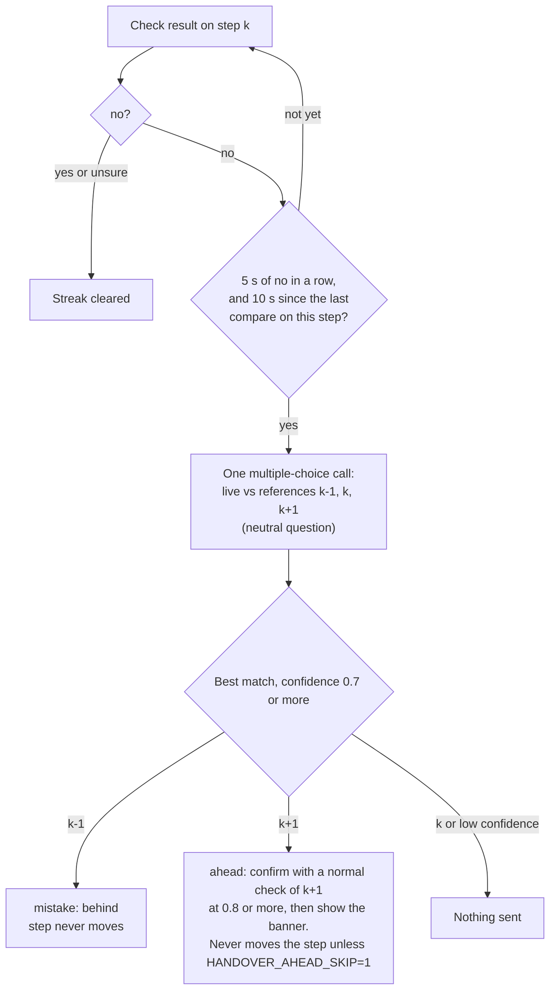

# Check pipeline

How a camera frame becomes "step done". Code: `server/check.py`, `server/gate.py`, `server/mistake.py`, driven by the engine in `server/main.py`. Every stage below is live.

Back to [server/README.md](../README.md).



| Stage | Status |
|---|---|
| Model check (Claude Haiku or Gemini), debounce, mock | Live |
| `last_check.reason` (what differs, up to 8 words) | Live |
| Pipelined confirm and fast path | Live |
| Motion gate | Live |
| Breaker | Live |
| Mistake check (policy, compare call, ahead confirm) | Live |

## 1. Motion gate

Calls the model only when the picture has settled and looks different from the last checked frame. Cuts calls on blurry, mid-motion frames. Pillow only.

How it measures: each JPEG is decoded to a small blurred gray image. "Difference" between two frames = the share of pixels whose gray value moved by more than a threshold.

| Decision | Rule (defaults; `HANDOVER_GATE_*` in `python -m server.config`) |
|---|---|
| Moving, hold | Difference from the previous frame over 2% |
| Still frame | Difference from the previous frame under 0.5% |
| Settled | 2 still frames in a row |
| Changed | Difference from the last checked frame over 1.8%, or nothing checked yet on this step |
| Allow | Settled and changed, or 6 s since the last check (heartbeat, which also runs during motion) |
| Unreadable frame | Held, never raises |
| Step change | Forgets the last check; motion history stays, so a still scene is checked at once |
| Off switch | `HANDOVER_GATE=0` allows every frame |

## 2. Model call

| Part | Value |
|---|---|
| Provider | `HANDOVER_CHECK_PROVIDER`: `auto` (Claude Haiku when `ANTHROPIC_API_KEY` is found, else Gemini), `claude`, or `gemini`. `state.check_mode` says which one runs |
| Model | Claude: `HANDOVER_CLAUDE_CHECK_MODEL` (`claude-haiku-5-5`). Gemini: `HANDOVER_CHECK_MODEL` (`gemini-3.5-flash-lite`) |
| Input | The step's reference frame, the live frame, the previous step's reference as a "before" example when there is one, and the step's `check_question` |
| Image size | Shrunk to `HANDOVER_CHECK_MAX_SIDE` (640) |
| Answer | Evidence first: `seen`, `differs` (what is missing, or `nothing`), `done` (`yes`, `no`, `unsure`), `confidence` |
| Guard | A `yes` that names a difference becomes `unsure`, so a contradiction never advances |
| Timeout | `HANDOVER_CHECK_TIMEOUT`, 3 s |
| Any error or timeout | `unsure`, confidence 0. `check_frame` never raises |
| Claude budget | $20 per day and $50 in total; at a cap no call is made (`budget`) |
| Result in state | `last_check: {done, confidence, latency_ms, reason}` |

Measured: one Claude Haiku check p50 about 1.1 to 1.3 s (5-call `server.check --time` runs).

## 3. Debounce and confirm

Answers are put in frame order, so checks running at once may finish in any order.

| Input | Effect |
|---|---|
| `yes` at `HANDOVER_MIN_CONF` (0.8) or more | Counts toward the debounce |
| `no`, `unsure`, or a lower yes on a newer frame | Resets it. A late answer for an older frame never outweighs a newer one |
| Newest `HANDOVER_DEBOUNCE_N` (2) answers are yes, from different frames | Pass |
| Fast path: one yes at `HANDOVER_FAST_CONF` (0.92) or more whose `differs` was `nothing`, on the newest frame answered | Pass at once (`HANDOVER_FAST_PATH=1`, the default) |
| Pass | `verified` and `next_clip` go out at once, the step moves after `HANDOVER_VERIFIED_HOLD` (0.8 s) with reason `camera` |
| Step change | Everything resets; answers from the old step are dropped |

Pipelined confirm: up to `HANDOVER_MAX_INFLIGHT` (2) checks run at once on one step, each on a different settled frame. A gate-triggered check lets one more start on the next settled frame instead of waiting for its answer. No extra check starts when the ones running can already finish the debounce.

## 4. Breaker

Stops calling the model when it is failing, so the learner is not stuck waiting. While open, no checks run and the UI shows "Checks off, use Next".



| `check_offline_reason` | Cause |
|---|---|
| `no_key` | No key for the active provider (only a restart with a key clears it) |
| `rate_limited` | The provider answered 429 (too many requests) |
| `errors` | 3 errors or timeouts in a row |
| `budget` | A Claude budget cap is reached |

## 5. Mistake check

Catches a learner who skipped or repeated a step. Policy in `mistake.py` (`MistakeWatch`), compare call in `check.compare_refs`, wiring in `main.py`.



| Detail | Value |
|---|---|
| Settle time | 5 s of consecutive `no` |
| Cooldown | 10 s per step |
| Minimum compare confidence | 0.7 (`HANDOVER_MISTAKE_MIN_CONF`) |
| Compare question | None from the engine: the compare uses a neutral question, not the current step's |
| `ahead`, default | One normal check of k+1 at 0.8 or more, then "You're ahead." shows; the step stays |
| `ahead`, `HANDOVER_AHEAD_SKIP=1` | The k+1 check at 0.9 or more and a normal check of step k saying yes on the same frame, then go to k+2. Otherwise the banner only |
| Why skip is off | Accuracy run (synthetic folds, real Claude Haiku): a learner who skipped a flip was called "ahead" in 15 of 23 tries, and the confirm said yes 4 of 6 times. A wrong skip is worse than a missed catch |
| `behind` message | The step's `common_mistake`, else `This still looks like step <looks_like + 1>.` |
| `source` | `claude`, `gemini` or `mock`: whoever answered |
| Parallel | The compare runs beside normal checks (`HANDOVER_MISTAKE_PARALLEL=1`) |

## 6. Mock modes

| Setting | Behavior |
|---|---|
| `HANDOVER_CHECK=mock` | No network. Each check waits 0.6 s, then answers yes 0.9 once the step has been active `HANDOVER_MOCK_PASS_SECONDS` (6), else no 0.85. 0.9 is under the fast-path bar, so mock always needs two yes answers |
| `HANDOVER_MOCK_MISTAKE=behind:<n>` or `ahead:<n>` | Mock mode only. After 4 s on 0-based step n, sends one mistake with `source: "mock"`, once per visit. Never set in a demo |
| `HANDOVER_TEACH_MOCK=1` | Teach side: no model, three placeholder manual steps |

## 7. Timing a provider

```sh
.venv/bin/python -m server.check --time REF.jpg LIVE.jpg "<check question>" -n 20
.venv/bin/python scripts/gemini_gate.py            # always Gemini (provider pinned)
.venv/bin/python scripts/eval_checks.py lessons/<id> --provider claude
```

`eval_checks.py --provider current|claude|gemini` (default `current`, what the hub would use) labels its report with the provider and model that ran.
