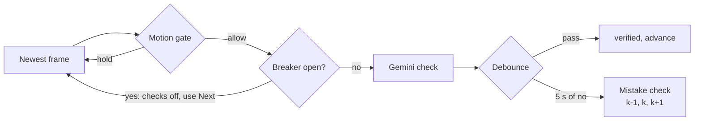
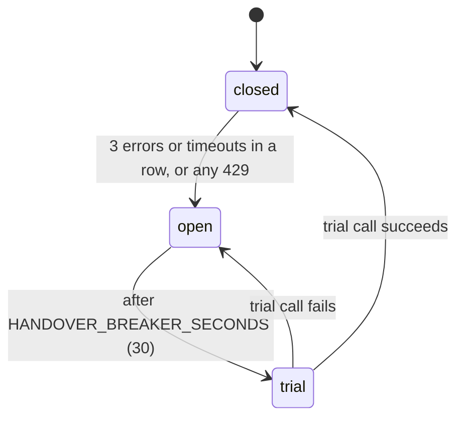
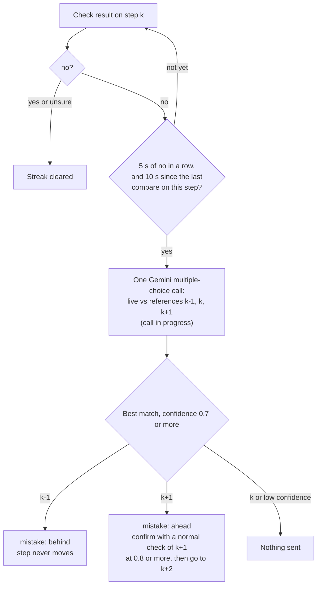

# Check pipeline

How a camera frame becomes "step done". Code: `server/check.py` (live), `server/gate.py` and `server/mistake.py` (built, not wired into `main.py` yet).

Back to [server/README.md](../README.md).



| Stage | Status |
|---|---|
| Gemini check, debounce, mock | Live |
| Motion gate | Built, not wired |
| Breaker | In progress |
| Mistake check policy | Built, not wired. The Gemini compare call is in progress |

## 1. Motion gate

Calls Gemini only when the picture has settled and looks different from the last checked frame. Cuts calls on blurry, mid-motion frames. Pillow only.

How it measures: each JPEG is decoded to a blurred 160 x 90 gray image. "Difference" between two frames = the share of pixels whose gray value moved by more than 25 levels.

| Decision | Rule (defaults from `MotionGate`) |
|---|---|
| Moving, hold | Difference from the previous frame over 2% |
| Still frame | Difference from the previous frame under 0.5% |
| Settled | 2 still frames in a row |
| Changed | Difference from the last checked frame over 3%, or nothing checked yet on this step |
| Allow | Settled and changed, or 6 s since the last check (heartbeat). Heavy motion blocks the heartbeat too |
| Unreadable frame | Held, never raises |
| Step change | `reset()` forgets the last check; motion history stays, so a still scene is checked at once |
| Off switch | `HANDOVER_GATE=0` allows every frame |

Cost per frame: `test_gate.py` fails above 10 ms per 1280 x 720 JPEG (target under 5 ms). The actual figure prints when the test runs; not recorded yet.

## 2. Gemini call

One call per allowed frame, one in flight.

| Part | Value |
|---|---|
| Model | `HANDOVER_CHECK_MODEL`, default `gemini-3.5-flash-lite`, API `v1beta` |
| Input, in order | Text "Reference: what the finished step looks like", reference JPEG, text "Live camera now", live JPEG, prompt with the step's `check_question` |
| Image size | Both downscaled to a 640 px long side |
| Settings | JSON schema output, low media resolution, minimal thinking, temperature 0, 256 output tokens max |
| Answer | `{"done": "yes" or "no" or "unsure", "confidence": 0 to 1}` |
| Prompt rules | yes only if clearly the same finished state; no if visible but not there yet; unsure if blocked or blurred; ignore background, light, hands, angle |
| Timeout | `HANDOVER_CHECK_TIMEOUT`, 3 s |
| Any error or timeout | `unsure`, confidence 0. `check_frame` never raises |
| Result in state | `last_check: {done, confidence, latency_ms}`. `reason` (up to 8 words) is in progress |

## 3. Debounce

| Input | Effect on the count |
|---|---|
| `yes` at `HANDOVER_MIN_CONF` (0.8) or more | +1 |
| `no`, `unsure`, or a lower yes | Back to 0 |
| Count reaches `HANDOVER_DEBOUNCE_N` (2) | Pass: `verified` for 1.2 s, then advance with reason `camera` |
| Step change | Back to 0 |

## 4. Breaker (in progress)

Stops calling Gemini when it is failing, so the learner is not stuck waiting. While open, no checks run and the UI shows "Checks off, use Next".



| `check_offline_reason` | Cause |
|---|---|
| `no_key` | No Gemini key found |
| `rate_limited` | Gemini answered 429 (too many requests) |
| `errors` | 3 errors or timeouts in a row |

Today, without the breaker: every failed call is logged and counts as unsure, so a step can only move by Next.

## 5. Mistake check

Catches a learner who skipped or repeated a step. Policy in `mistake.py` (`MistakeWatch`), tested in `test_mistake.py`.



| Detail | Value |
|---|---|
| Settle time | 5 s of consecutive `no` (`unsure` breaks the streak, `yes` resets it) |
| Cooldown | 10 s per step, remembered across step changes |
| Minimum compare confidence | 0.7 (`HANDOVER_MISTAKE_MIN_CONF`) |
| `ahead` confirm | One normal check of k+1 at 0.8 or more |
| `behind` message | The step's `common_mistake`, else `This still looks like step <looks_like + 1>.` |
| `ahead` message | `You're ahead.` |
| Last step | No `ahead` (there is no k+1) |
| First step | No `behind` |

## 6. Mock modes

| Setting | Behavior |
|---|---|
| `HANDOVER_CHECK=mock` | No network. Each check waits 0.6 s, then answers yes 0.9 once the step has been active `HANDOVER_MOCK_PASS_SECONDS` (6), else no 0.85 |
| `HANDOVER_MOCK_MISTAKE=behind:<n>` or `ahead:<n>` | Mock mode only. After 4 s on 0-based step n, sends one mistake with confidence 0.9 and `source: "mock"`, once per visit. Ignored outside mock mode and when malformed. Never set in a demo |
| `HANDOVER_TEACH_MOCK=1` | Teach side: no Gemini, three placeholder manual steps |

The real compare call is never made in mock mode.

## 7. The 6 PM gate

From docs/PLAN.md. Measure first:

```sh
.venv/bin/python -m server.check --time REF.jpg LIVE.jpg "<check question>" -n 20
```

It prints each call, then p50 (median), p90 and max latency.

| Median latency | Decision |
|---|---|
| 2.0 s or less | Pass, keep the defaults |
| Over 2.0 s, up to 2.5 s | Widen the motion gate (fewer calls) |
| Over 2.5 s | One confident yes plus Next. One yes is the setting `HANDOVER_DEBOUNCE_N=1` |

Measured latency: not measured yet.
