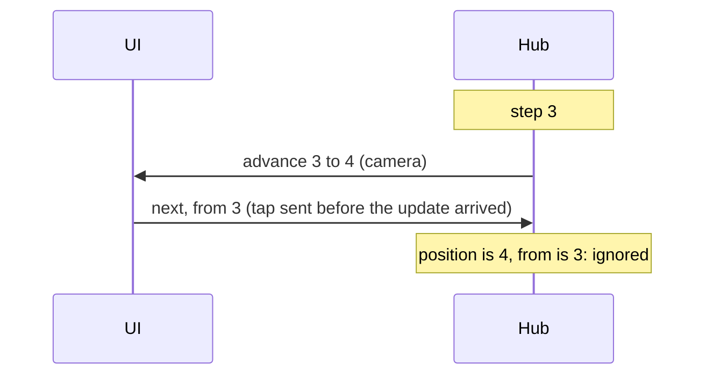

# Learn engine

One global session in `server/main.py` (`Engine`). It holds the lesson, the current step and the newest camera frame, and it tells every `/ws/ui` viewer what to show.

Back to [server/README.md](../README.md).

## States

`status` in the `state` message. When two apply, the higher one wins: `done` > `manual` > `verified` > `checking` > `watching`.

| Status | Means | Leaves by |
|---|---|---|
| `watching` | Camera step, checks run quietly | Camera pass, Next, Back, goto |
| `checking` | A check has been in flight for over 1.5 s. Shown only then, so the badge does not flicker | Result arrives |
| `verified` | Debouncer passed. Sent at once with `next_clip`, so the badge shows and the next clip preloads now; held `HANDOVER_VERIFIED_HOLD` (0.8 s) | Automatic advance with reason `camera` |
| `manual` | Step has `check_type: "manual"`. The camera is not judged | Next (button, voice, or phone) |
| `done` | Position equals `total`, or the lesson has no steps | Back or goto |

With no lesson: `watching`, `step 0`, `total 0`, `rev 0`.

### Mistake overlay (live)

Not a status. A separate `mistake` field in `state` (CONTRACT 7), set when the mistake check fires and cleared on step change, `dismiss_mistake`, or a yes on this step. `behind` and `ahead` never move the step; only `HANDOVER_AHEAD_SKIP=1` lets a doubly confirmed `ahead` skip to k+2. With `HANDOVER_LIVE_MISTAKES=1`, understanding can also raise an advisory `live` mistake with a `label`; it never moves the step. See [checks.md](checks.md#5-mistake-check).

### Extra state fields (live, proposed in the contract)

| Field | Meaning |
|---|---|
| `check_mode` | `mock`, `claude` or `gemini`: who answers the checks |
| `next_clip` | The next step's clip as a lesson-relative path such as `"clips/03.mp4"`, as soon as this step has one confident yes (and while `verified`); null otherwise and on the last step |
| `progress`, `stage` | From understanding (`HANDOVER_UNDERSTAND=1` and a rubric): 0 to 1, and `{index, count, label}`; null otherwise. Reset on step change |

## Moving between steps

All moves go through `go(to, reason)`.

| Rule | Detail |
|---|---|
| Position | `total` when done, else `step` (0-based) |
| Clamp | `to` is clamped to `0..total`; equal to position does nothing |
| Finish | `to == total` sets done and keeps `step = total - 1` |
| Order of messages | `advance {from, to, reason}`, then `state` |
| Reasons | `camera`, `button`, `voice`. Any other reason from a client counts as `button` |
| On every change | Debouncer reset, `last_check` cleared, `verified` and `checking` off, step clock restarted, frames taken before the step began are skipped |

Commands from `/ws/ui`:

| Message | Effect |
|---|---|
| `select_lesson {id, token}` | Load lesson, step 0, new `rev`. Optional `token` (a sign-in token) tags the run with the learner's user id; without one the run is anonymous |
| `next {reason, from}` | `go(position + 1)` |
| `back {from}` | `go(position - 1)`, reason `button` |
| `goto {step}` | Only `0 <= step < total` |

Anything but `select_lesson` with no lesson loaded gets `error: no lesson selected`.

## Stale guard (`from`)

`next` and `back` may carry `from`: the step the client was showing. If the hub has moved since (a camera advance, a second tap), the command is dropped and logged as `ignored stale`.

| `from` | Result |
|---|---|
| Absent | Always applied (older clients) |
| Equals position | Applied |
| On the done screen, equals `total - 1` or `total` | Applied |
| Anything else, or not an integer | Ignored |

A camera advance that is in its 0.8 s `verified` hold is also cancelled if a button moves the step first.

## rev

`rev` is the `lesson.json` modification time in milliseconds. It changes on `select_lesson` and after a recut through `POST /api/lessons/{id}/recut`. When it changes, clients refetch the lesson and add `?v=<rev>` to clip, caption and frame URLs.

A recut from the command line (`python -m server.teach --recut`) does not tell a running hub. Re-select the lesson afterward, or use the HTTP endpoint.

## Cameras

| Rule | Live |
|---|---|
| Who is judged | Only the active camera: the one that connected or sent `hello` most recently |
| Takeover | Active camera silent for 5 s and another sent a frame: the other becomes active |
| `camera_connected` broadcast | On 0 to 1 and 1 to 0 cameras, and on active camera change |
| `camera` in state | `{name, platform, source}`; `source: "file"` shows the Recording banner |
| No hello | `name: "Camera <n>"`, `platform: "other"`, `source: "unknown"` (never guessed) |
| `platform` in hello | `ios`, `android`, `web`, `macos`, `windows`, `linux`, `replay`; any other string becomes `other` and the hello still counts |
| Same `device_id` reconnects | Older socket closed with code 4000 `replaced` |
| Frames over 2 MB, or closer than 0.2 s (`HANDOVER_MIN_FRAME_GAP`) | Ignored. 0.2 s allows the clients' 2 fps |

Frames stay in memory. The engine never writes them to disk.

## Check loop

- Runs only on a camera step, with a camera connected, a readable `ref_frame`, and not during `verified`.
- Up to `HANDOVER_MAX_INFLIGHT` (2) checks at once, each on a different settled frame; answers are debounced in frame order. See [checks.md](checks.md#3-debounce-and-confirm).
- With `HANDOVER_UNDERSTAND=1` and a rubric entry for the step, an understanding call runs beside each check on the same frame; the debounce sees yes only when both say yes.
- If the step changed while a check ran, or the step is already verified, its result is thrown away.
- `state` from check results goes out only when it differs from the last state sent, so two checks giving the same answer send one state. Commands (`select_lesson` and the rest) always get their state.

## Latency

Measured with `scripts/latency_bench.py`: in-process engine, mock mode, a stand-in check of fixed latency, 8 trials per row, 0.8 s hold. "Settled" is the frame the motion gate first lets through; "finished" is the first frame of the finished scene. p50 in seconds (p90 within 0.01 s of it).

| Check latency, camera fps | Before (1 check at a time) | Pipelined | Pipelined + fast path (yes at 0.95) |
|---|---|---|---|
| 600 ms, 1 fps: settled to advance | 2.40 | 2.40 | 1.40 |
| 1200 ms, 1 fps: settled to advance | 3.20 | 3.00 | 2.00 |
| 1200 ms, 2 fps: settled to advance | 3.20 | 2.50 | 2.00 |

What this shows:
- Pipelining only helps when a check takes longer than the gap between frames; the old loop already started the confirm on the frame that arrived meanwhile. At 2 fps and 1.2 s (about the measured Claude Haiku p50) it saves 0.7 s.
- The fast path saves one check latency, when the model is that sure and names no difference. Mock answers 0.9, so it never takes the fast path.
- Of what is left, 0.8 s is the hold, and finished to settled (2 still frames, so 2 frame gaps) is the next biggest piece; `HANDOVER_GATE_STILL_FRAMES=1` would cut one frame gap but is not changed here.
- `HANDOVER_UNDERSTAND=1` with a stand-in of the same latency adds nothing measurable (both calls run at once) but doubles the calls.

## Timing constants

| Constant | Value | Where |
|---|---|---|
| `VERIFIED_HOLD` | 0.8 s (`HANDOVER_VERIFIED_HOLD`) | `main.py` |
| `CHECKING_SHOW_AFTER` | 1.5 s | `main.py` |
| `UI_FRAME_MIN_INTERVAL` | 0.25 s (at most 4 frames per second to viewers) | `main.py` |
| `UI_FRAME_MAX_SIDE` | 960 px, JPEG quality 75 | `main.py` |
| Viewer frame drop | When a viewer has more than 2 queued messages | `main.py`, `UIClient.push` |
| Check timeout | 3 s (`HANDOVER_CHECK_TIMEOUT`) | `check.py` |
| Debounce | 2 yes at 0.8 or more on different frames, or one yes at 0.92 (`HANDOVER_DEBOUNCE_N`, `HANDOVER_MIN_CONF`, `HANDOVER_FAST_CONF`) | `main.py`, `FrameDebouncer` |
| Checks at once | 2 (`HANDOVER_MAX_INFLIGHT`) | `main.py` |
| Active camera silence | 5 s | `main.py` |
