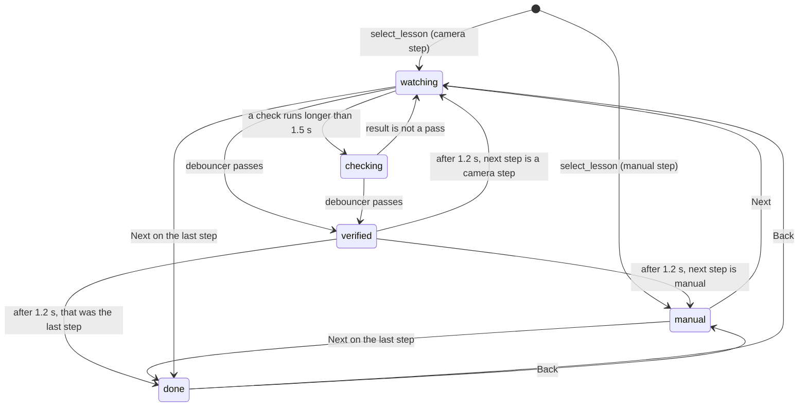
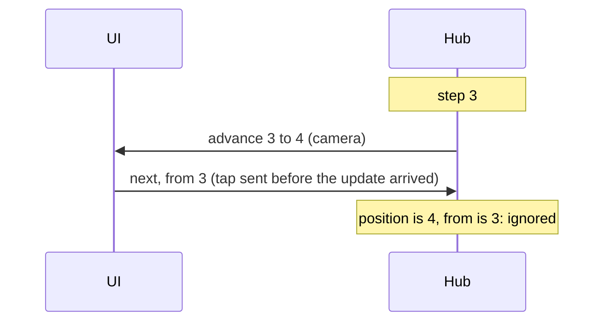

# Learn engine

One global session in `server/main.py` (`Engine`). It holds the lesson, the current step and the newest camera frame, and it tells every `/ws/ui` viewer what to show.

Back to [server/README.md](../README.md).

## States

`status` in the `state` message. When two apply, the higher one wins: `done` > `manual` > `verified` > `checking` > `watching`.

| Status | Means | Leaves by |
|---|---|---|
| `watching` | Camera step, checks run quietly | Camera pass, Next, Back, goto |
| `checking` | A check has been in flight for over 1.5 s. Shown only then, so the badge does not flicker | Result arrives |
| `verified` | Debouncer passed. Held 1.2 s so the UI can show it and chime | Automatic advance with reason `camera` |
| `manual` | Step has `check_type: "manual"`. The camera is not judged | Next (button, voice, or phone) |
| `done` | Position equals `total`, or the lesson has no steps | Back or goto |

With no lesson: `watching`, `step 0`, `total 0`, `rev 0`.

### Mistake overlay (in progress)

Not a status. A separate `mistake` field in `state` (CONTRACT 7), set when the mistake check fires and cleared on step change, `dismiss_mistake`, or a yes on this step. A `behind` mistake never moves the step. The policy code exists in `mistake.py`; the engine does not call it yet. See [checks.md](checks.md#mistake-check).

## Moving between steps

All moves go through `go(to, reason)`.

| Rule | Detail |
|---|---|
| Position | `total` when done, else `step` (0-based) |
| Clamp | `to` is clamped to `0..total`; equal to position does nothing |
| Finish | `to == total` sets done and keeps `step = total - 1` |
| Order of messages | `advance {from, to, reason}`, then `state` |
| Reasons | `camera`, `button`, `voice`. The code also accepts `timer` from `/ws/ui`; CONTRACT.md does not list it |
| On every change | Debouncer reset, `last_check` cleared, `verified` and `checking` off, step clock restarted, frames taken before the step began are skipped |

Commands from `/ws/ui`:

| Message | Effect |
|---|---|
| `select_lesson {id}` | Load lesson, step 0, new `rev` |
| `next {reason, from}` | `go(position + 1)` |
| `back {from}` | `go(position - 1)`, reason `button` |
| `goto {step}` | Only `0 <= step < total` |

Anything but `select_lesson` with no lesson loaded gets `error: no lesson selected`.

## Stale guard (`from`)

`next` and `back` may carry `from`: the step the client was showing. If the hub has moved since (a camera advance, a second tap), the command is dropped and logged as `ignored stale`.

| `from` | Result |
|---|---|
| Absent | Always applied (older clients) |
| Equals position | Applied |
| On the done screen, equals `total - 1` or `total` | Applied |
| Anything else, or not an integer | Ignored |

A camera advance that is in its 1.2 s `verified` hold is also cancelled if a button moves the step first.

## rev

`rev` is the `lesson.json` modification time in milliseconds. It changes on `select_lesson` and after a recut through `POST /api/lessons/{id}/recut`. When it changes, clients refetch the lesson and add `?v=<rev>` to clip, caption and frame URLs.

A recut from the command line (`python -m server.teach --recut`) does not tell a running hub. Re-select the lesson afterward, or use the HTTP endpoint.

## Cameras

| Rule | Today (live) | Planned (in progress, CONTRACT 5 and 6) |
|---|---|---|
| Who is judged | Every connected camera writes to one "newest frame" slot; the last write wins | Only the active camera: the one that connected or sent `hello` most recently |
| Takeover | None | Active camera silent for 5 s and another sent a frame in the last 2 s: the other becomes active |
| `camera_connected` broadcast | On 0 to 1 and 1 to 0 cameras | Also on active camera change |
| `camera` in state | Not sent | `{name, platform, source}`; `source: "file"` shows the Recording banner |
| Same `device_id` reconnects | Not handled | Older socket closed with code 4000 `replaced` |
| Frames over 2 MB | Not filtered | Ignored |

Frames stay in memory. The engine never writes them to disk.

## Check loop

- Runs only on a camera step, with a camera connected, a readable `ref_frame`, and not during `verified`.
- One check in flight. When it returns, the newest frame is checked next; frames in between are skipped.
- If the step changed while a check ran, its result is thrown away.
- `state` is broadcast only when status, answer or confidence changed, not after every identical result.

## Timing constants

| Constant | Value | Where |
|---|---|---|
| `VERIFIED_HOLD` | 1.2 s | `main.py` |
| `CHECKING_SHOW_AFTER` | 1.5 s | `main.py` |
| `UI_FRAME_MIN_INTERVAL` | 0.25 s (at most 4 frames per second to viewers) | `main.py` |
| `UI_FRAME_MAX_SIDE` | 960 px, JPEG quality 75 | `main.py` |
| Viewer frame drop | When a viewer has more than 2 queued messages | `main.py`, `UIClient.push` |
| Check timeout | 3 s (`HANDOVER_CHECK_TIMEOUT`) | `check.py` |
| Debounce | 2 yes at 0.8 or more (`HANDOVER_DEBOUNCE_N`, `HANDOVER_MIN_CONF`) | `check.py` |
| Active camera silence | 5 s, with a 2 s window for the other camera | In progress |
