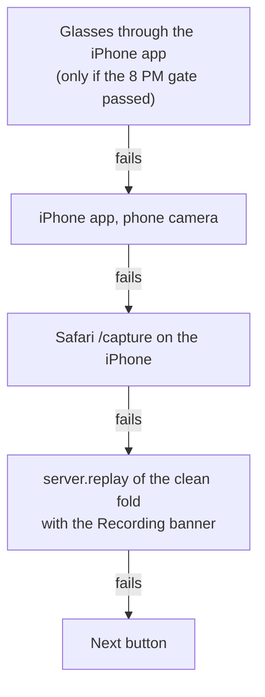

# Operations: demo-day runbook

What to run on the Mac, in order, and what to do when something breaks.

Back to [server/README.md](../README.md).

## 1. Start the hub

```sh
scripts/run_server.sh
```

| Check | Expect |
|---|---|
| Log line | `lessons: <path>  check: claude claude-haiku-5-5` or `check: gemini <model>` (says `mock` if `HANDOVER_CHECK=mock` is set: unset it for the demo) |
| Phone line | `Phone camera page: https://<IP>:8443/capture` (only when certs exist) |
| Lessons | `curl -s http://localhost:8000/api/lessons` lists both lessons |

Learn screen: the hub serves the built web app at `http://<IP>:8000/` when `web/dist` exists (`npm --prefix web run build`); otherwise `npm --prefix web run dev`, then `http://localhost:5173`.

## 2. Camera

```sh
scripts/certs.sh     # once per network; rerun if the Mac's IP changes
```

Open `https://<IP>:8443/capture` in iPhone Safari. The phone and Mac must be on the same network or hotspot. The mkcert root must be trusted on the phone once (the script prints the steps).

## 3. Replay a recording as the camera

```sh
.venv/bin/python -m server.replay recordings/fold.mp4 --select fortune-teller-v1
```

| Option | Default | Use |
|---|---|---|
| `--url` | `ws://localhost:8000/ws/camera` | Another hub |
| `--fps` | 1 | Frames per second sent |
| `--loop` | off | Repeat the file |
| `--start` | 0 | Start offset in seconds |
| `--select` | none | Select this lesson first; exits if the hub refuses |

It reconnects every 2 s if the hub drops. It sends `hello` with `source: "file"` first, so the web app shows the "Recording" banner.

## 4. Smoke and watch

```sh
.venv/bin/python scripts/smoke.py run --lesson demo-v1     # PASS/FAIL table against a running hub
.venv/bin/python scripts/smoke.py watch                    # one line per state, advance, mistake, error
.venv/bin/python scripts/e2e_demo.py                       # full web flow in Chrome against a mock hub
```

`demo-v1` is a synthetic test pattern (colored bars), not a real lesson.

## 5. Fallback ladder

Drop one rung only when the one above fails. Next always works.



The iPhone app lives in `ios/` (Pranav's lane) and is not in this branch.

## 6. Breaker and the provider down

The breaker turns checks off after 3 errors or timeouts in a row, any 429 (rate limit), or a reached Claude budget cap, for 30 s, then tries one call. The UI shows "Checks off, use Next". This is expected behavior, not a crash. `python -m server.spend` shows what Claude has cost today and in total against the $20 per day and $50 total caps.

If the provider is down or slow:

1. Keep going with Next. Say "the camera check is off, so I'll press Next."
2. Switch provider: set `HANDOVER_CHECK_PROVIDER=gemini` (or `claude`) and restart the hub.
3. Do not switch to `HANDOVER_CHECK=mock` in front of judges. Mock passes on a timer, not on what the camera sees.

The log says `check failed` or `check timed out` for each failed call.

## 7. 8 AM rehearsal count

From docs/PLAN.md: 20 folds under venue light.

| Count | Rule |
|---|---|
| Planted skipped flip caught in 18 or more of 20 | Keep the catch in the demo |
| Fewer than 18 | Step 5 becomes manual and the plant moves |

Also log camera-verified steps, manual steps, false passes and false alarms. Results: not measured yet.

## 8. Privacy

Frames go from the hub to the AI provider (Claude or Gemini, whichever `state.check_mode` names) for each check (with `HANDOVER_UNDERSTAND=1`, also to Claude for the understanding call) and are never written to disk. The test `test_privacy_learn_frames_never_touch_disk` in `server/test_engine.py` runs a full mock session with every file write blocked under the repo and the lessons folder, and fails on any written frame. Learn events (metadata, no images) go to `logs/events.jsonl` and, with credentials, to Databricks.

## Troubleshooting

| Symptom | Likely cause | Fix |
|---|---|---|
| No `Phone camera page` line at start | No certs | `scripts/certs.sh` |
| Safari will not open the camera | Page opened over http, or root not trusted | Use `https://...:8443/capture`; trust the mkcert root on the phone |
| Capture page worked yesterday, not today | Mac IP changed | Rerun `scripts/certs.sh`, restart the hub |
| Hub exits at start | Port 8000 or 8443 in use (another hub) | `lsof -nP -iTCP:8000 -sTCP:LISTEN`, stop that process |
| Steps never advance by camera | Manual step, no camera connected, or no lesson selected | Check `status` and `camera_connected` in state; select the lesson |
| Log: `reference frame missing` | `frames/NN.jpg` gone | Recut the lesson |
| `last_check` is `unsure`, 0 every time | Provider failing: key, network, model id, budget | Read the `check failed` log line; see section 6 |
| Checks off with reason `no_key` | No key for the active provider | Add `ANTHROPIC_API_KEY` or `GEMINI_API_KEY` to `.env`, restart |
| Checks off with reason `budget` | A Claude cap is reached | `python -m server.spend`; switch to Gemini or raise the cap on purpose |
| Status stays `checking` | Calls take over 1.5 s | Run `server.check --time`; see [checks.md](checks.md#7-timing-a-provider) |
| Advances too early | Question too loose, or debounce too low | Tighten `check_question`, raise `HANDOVER_DEBOUNCE_N` |
| UI shows old clips after a recut | Recut ran from the command line, hub not told | Re-select the lesson, or recut with `POST /api/lessons/<id>/recut` |
| Replay crashes with `FileNotFoundError: 'ffmpeg'` | Replay looks only on PATH (teach also checks Homebrew) | `export PATH=/opt/homebrew/bin:$PATH` |
| Replay: `select_lesson failed: lesson not found` | Wrong id | `curl -s http://localhost:8000/api/lessons` |
| Teach job error: `not ACTIVE after 300 s` | Gemini still processing the upload | Retry; try a shorter take |
| Teach job error: `ffmpeg not found on PATH` | ffmpeg missing | `brew install ffmpeg` |
