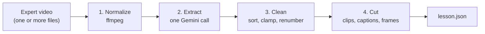

# Teach pipeline

One expert video in, one lesson folder of captioned step clips out. Code: `server/teach.py`.

Back to [server/README.md](../README.md).



## Run it

From the repo root.

```sh
# New lesson from one take
.venv/bin/python -m server.teach takes/fold.mov --id fortune-teller-v1 --title "Fold a fortune teller"

# Several files joined in order
.venv/bin/python -m server.teach part1.mov --concat part2.mov part3.mov --id bike-wheel-v1 --title "Remove a bike front wheel"

# Your own steps instead of Gemini (same JSON shape as the extraction)
.venv/bin/python -m server.teach demo.mp4 --id demo-v1 --title "Demo lesson" --steps-json steps.json

# Rebuild clips after editing lesson.json
.venv/bin/python -m server.teach --recut lessons/fortune-teller-v1
```

| Argument | Meaning |
|---|---|
| `VIDEO` | First video. Required unless `--recut` |
| `--id` | Lesson id. Required unless `--recut`. Lowercased; anything outside `a-z0-9-` becomes `-` |
| `--title` | Defaults to the id |
| `--concat FILE...` | More videos appended after `VIDEO` |
| `--steps-json FILE` | Skip Gemini, use these steps and transcript |
| `--recut LESSON_DIR` | Rebuild from the folder's `lesson.json` and `extraction.json` |

The web Teach screen does the same through `POST /api/lesson`, with job status `queued`, `normalizing`, `extracting`, `cutting`, `done` or `error` at `GET /api/jobs/{job}`. A failed job removes its half-built folder.

## 1. Normalize

| Output property | Value |
|---|---|
| Size | 1080 px tall, width to match |
| Frame rate | 30 fps, constant |
| Video | H.264, CRF 20, preset veryfast, `yuv420p` |
| Audio | AAC 48 kHz stereo. Silent track added when the input has none |
| Color | Tagged SDR bt709. iPhone HDR (PQ or HLG) is converted so browsers show normal colors |
| Web | `faststart`, so playback starts before the whole file loads |

Several inputs are normalized one by one, then joined without re-encoding.

## 2. Extract (one Gemini call)

| Part | Value |
|---|---|
| Model | `HANDOVER_TEACH_MODEL`, default `gemini-3.8-flash` |
| Upload | Gemini Files API; waits up to 300 s for the file to be ready, deletes it after |
| Sampling | 2 fps, retried without the fps setting if the model rejects it |
| Boundaries | Narration first ("now fold...", "next..."), confirmed by the video. Steps contiguous, 3 to 12 preferred |
| Per step | `start`, `end` (`MM:SS`), `title` (4 to 8 word instruction), `check_question` or the word `manual`, `prerequisites` |
| Also | Transcript segments with start and end in seconds |
| Mock | `HANDOVER_TEACH_MOCK=1`: three equal placeholder steps, all manual |

On failure the error suggests `gemini-3.1-pro-preview`. That model is cut from scope in docs/PLAN.md; do not switch to it.

## 3. Clean

Steps are sorted by start, clamped to the video length, steps shorter than 0.5 s are dropped, and prerequisites are renumbered to match. No usable steps is an error.

## 4. Cut and captions

| Per step NN | How |
|---|---|
| `clips/NN.mp4` | Re-encoded from `norm.mp4` between `start` and `end` |
| `captions/NN.vtt` | Transcript segments inside the step, shifted to start at 0 |
| `frames/NN.jpg` | Reference frame (see below) |
| `check_type` | `manual` when the question is `manual` or empty, else `camera` |

Every timestamp is validated before anything is cut. A step under 0.2 s after clamping is an error. New files are built in `.recut_tmp/` and swapped in only when every step succeeds, so a bad timestamp or an ffmpeg failure leaves the old lesson playing.

## Reference frame selection

| | Rule |
|---|---|
| Today (live) | Last frame of the clip (tries 0.1 s, 0.5 s, then 1.0 s from the end) |
| Planned, M8 (in progress) | Stillest hands-free frame in the last 15% of the clip; time saved as `ref_time`. Step 1 made manual on new extractions. Check questions about shape and seam count, not color |

## Self-test (in progress, S-T)

At teach time each step's question is asked against its own reference (expect yes) and the previous step's reference (expect no). Steps that fail are suggested as manual. Result saved as `self_test: {own, prev, ok}`. No code yet.

## Lesson folder

```
lessons/<id>/
  lesson.json        steps, timestamps, questions (CONTRACT 3)
  extraction.json    steps and transcript from Gemini; recut reads the transcript
  norm.mp4           the normalized full video
  clips/01.mp4 ...
  captions/01.vtt ...
  frames/01.jpg ...
```

`.recut_tmp/` and `.recut_old/` exist only during a cut. Uploads wait in `server/uploads/` and are deleted when the job ends.

## Fix two timestamps and recut

Example: the boundary between steps 3 and 4 is 1 s late.

1. Open `lessons/<id>/lesson.json`.
2. Change step 3 `end` and step 4 `start` to the same new time, for example `"01:14.5"`. Accepted: `MM:SS`, `MM:SS.s`, `HH:MM:SS`, plain seconds.
3. Recut. With the hub running, use the endpoint so the hub reloads the lesson and sends a new `rev`:

   ```sh
   curl -X POST http://localhost:8000/api/lessons/<id>/recut
   ```

   Hub not running:

   ```sh
   .venv/bin/python -m server.teach --recut lessons/<id>
   ```

4. Play both clips in the Teach screen.

A bad timestamp returns 400 with the reason and the old `lesson.json` is restored.

## Recut rule

| | What recut keeps |
|---|---|
| Today (live) | Rebuilds `lesson.json` from `id`, `title`, and per step `title`, `start`, `end`, `check_type`, `check_question`, `prerequisites`. Every other field is dropped. A camera step with an empty question becomes manual |
| Planned, M8 (in progress) | Rewrites only `n`, `start`, `end`, `clip`, `captions`, `ref_frame`, `check_question`, `prerequisites`; keeps every other field (`common_mistake`, `ref_time`, `self_test`, `safety`, `tools`) |

Until the planned rule lands, re-add hand-written fields such as `common_mistake` after each recut.
