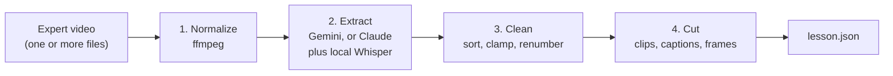

# Teach pipeline

One expert video in, one lesson folder of captioned step clips out. Code: `server/teach.py`.

Back to [server/README.md](../README.md).



## Run it

From the repo root.

```sh
# New lesson from one take
.venv/bin/python -m server.teach takes/fold.mov --id fortune-teller-v1 --title "Fold a fortune teller"

# Several files joined in order
.venv/bin/python -m server.teach part1.mov --concat part2.mov part3.mov --id bike-wheel-v1 --title "Remove a bike front wheel"

# Your own steps instead of Gemini (same JSON shape as the extraction)
.venv/bin/python -m server.teach demo.mp4 --id demo-v1 --title "Test pattern (not a real lesson)" --steps-json steps.json

# Rebuild clips after editing lesson.json
.venv/bin/python -m server.teach --recut lessons/fortune-teller-v1

# Known task, silent take: template as a prior, titles and questions from the frames, failing steps manual
.venv/bin/python -m server.teach take.mov --id fortune-teller-v2 --title "Fold a fortune teller" \
  --prior lessons/templates/fortune-teller.steps.json --retitle --strict-self-test
```

Windows, the whole pipeline in one command (teach, contact sheet, voiceover, lint, step table):

```powershell
scripts\make_lesson.ps1 -Video takes\fold2.mov -Id fortune-teller-v2 -Title "Fold a fortune teller" `
    -Template lessons\templates\fortune-teller.steps.json
# look at lessons\fortune-teller-v2\review\sheet.jpg, move start/end in lesson.json, then
scripts\make_lesson.ps1 -Id fortune-teller-v2 -Recut
```

## Cuts from done moments (vision boundaries)

For a silent take add `-NoSpeech` (Whisper would turn room noise into invented lines) and the cuts come from the model seeing when each step is DONE, not from pauses or stillness:

1. Pass 1: frames every `HANDOVER_TEACH_SAMPLE_S` (1.0 s) across the whole take, tiled into contact sheets, one call to `HANDOVER_TEACH_BOUNDARY_MODEL` (claude-sonnet-5-5, Haiku if it fails) with the template's step list as the prior. For each step it returns the first time its end state is clearly visible, with one reason.
2. Pass 2: frames every 0.25 s in a 2 s window around each coarse time; the model picks the first frame where the end state is reached. That frame is the cut and, unless a frame in the last second shows less hand on the paper, the reference frame.
3. Both passes, with model, token use and reasons, are written to `lessons/<id>/review/boundaries.json`; `review/sheet.jpg` draws each step's first, middle, reference and last frame plus the pass 2 window with the chosen cut outlined.

`--boundaries vision` on `python -m server.teach` (the default for `make_lesson.ps1 -NoSpeech`); `legacy` is the one-call extraction. A human-edited lesson.json always wins on `-Recut`. About 3 cents per take.

`-Recut` recuts from the edited lesson.json, chooses every reference frame again (`-KeepRefTimes` keeps hand-set `ref_time` values that still fall inside their step), rewrites the questions from the new frames (`-Retitle` also the titles), self-tests, redraws the sheet and voices again. `-NoVoice` skips the voiceover. A new build refuses an existing id.

| Argument | Meaning |
|---|---|
| `VIDEO` | First video. Required unless `--recut` |
| `--id` | Lesson id. Required unless `--recut`. Lowercased; anything outside `a-z0-9-` becomes `-` |
| `--title` | Defaults to the id |
| `--concat FILE...` | More videos appended after `VIDEO` |
| `--steps-json FILE` | Skip Gemini, use these steps and transcript |
| `--recut LESSON_DIR` | Rebuild from the folder's `lesson.json` and `extraction.json`. Drops a `voiceover` field (the new clips carry the take's audio) |
| `--prior FILE` | Known task: a steps template (`lessons/templates/*.steps.json`) sent to the Claude extraction as a strong prior (order, titles, questions); its times are ignored. Gemini ignores it |
| `--retitle` | After the cut, rewrite every title, check question and common mistake from the step's BEFORE, DURING and DONE frames in one call, so title and question name the same shape. A question the model calls `manual` makes the step manual; step 1 stays manual |
| `--strict-self-test` | Every step that fails the automatic self-test becomes manual (default: only steps whose own reference fails) |
| `--repick` | With `--recut`: clear every `ref_time` first, so all reference frames are chosen again |
| `--self-test LESSON_DIR` | Run the self-test only |
| `--table LESSON_DIR` | Print the step table (n, title, start, end, check type, question, self-test) |

The web Teach screen does the same through `POST /api/lesson`, with job status `queued`, `normalizing`, `extracting`, `cutting`, `done` or `error` at `GET /api/jobs/{job}`. A failed job removes its half-built folder.

## 1. Normalize

| Output property | Value |
|---|---|
| Size | 1080 px tall, width to match |
| Frame rate | 30 fps, constant |
| Video | H.264, CRF 20, preset veryfast, `yuv420p` |
| Audio | AAC 48 kHz stereo. Silent track added when the input has none |
| Color | Tagged SDR bt709. iPhone HDR (PQ or HLG) is converted so browsers show normal colors |
| Web | `faststart`, so playback starts before the whole file loads |

Several inputs are normalized one by one, then joined without re-encoding.

## 2. Extract

`HANDOVER_TEACH_PROVIDER=auto` uses Gemini when a Gemini key is found, else Claude when `ANTHROPIC_API_KEY` is found, else placeholder steps.

| Provider | How |
|---|---|
| Gemini | One call with the whole video; the model hears the narration itself |
| Claude | Frames only (`HANDOVER_CLAUDE_TEACH_MODEL`), plus a narration transcript made on this Mac by faster-whisper (`HANDOVER_WHISPER_MODEL`, `HANDOVER_TRANSCRIBE`). Without a transcript it falls back to frames only |

Gemini details:

| Part | Value |
|---|---|
| Model | `HANDOVER_TEACH_MODEL`, default `gemini-3.8-flash` |
| Upload | Gemini Files API; waits up to 300 s for the file to be ready, deletes it after |
| Sampling | 2 fps, retried without the fps setting if the model rejects it |
| Boundaries | Narration first ("now fold...", "next..."), confirmed by the video. Steps contiguous, 3 to 12 preferred |
| Per step | `start`, `end` (`MM:SS`), `title` (4 to 8 word instruction), `check_question` or the word `manual`, `prerequisites` |
| Also | Transcript segments with start and end in seconds |
| Mock | `HANDOVER_TEACH_MOCK=1`: three equal placeholder steps, all manual |

On failure the error suggests `gemini-3.1-pro-preview`. That model is cut from scope in docs/PLAN.md; do not switch to it.

## 3. Clean

Steps are sorted by start, clamped to the video length, steps shorter than 0.5 s are dropped, and prerequisites are renumbered to match. No usable steps is an error.

## 4. Cut and captions

| Per step NN | How |
|---|---|
| `clips/NN.mp4` | Re-encoded from `norm.mp4` between `start` and `end` |
| `captions/NN.vtt` | Transcript segments inside the step, shifted to start at 0 |
| `frames/NN.jpg` | Reference frame (see below) |
| `check_type` | `manual` when the question is `manual` or empty, else `camera` |

Every timestamp is validated before anything is cut. A step under 0.2 s after clamping is an error. New files are built in `.recut_tmp/` and swapped in only when every step succeeds, so a bad timestamp or an ffmpeg failure leaves the old lesson playing.

## Reference frame selection

| | Rule |
|---|---|
| Live | Stillest, not black frame in the last 15% of the clip (the model's `ref_time` hint is used when it is valid); the time is saved as `ref_time`. Without one, the last frame of the clip. Step 1 is made manual on new extractions. Questions that name colors are reworded or made manual |
| Hands-free | That frame must be hands-free still (mean 96x96 gray difference to its neighbours at 10 fps of 0.8 or less). If not, a still frame elsewhere in the window wins, else the first still pause up to 2.5 s after the step end (saved as a null `ref_time`; found again on every recut) |
| Hands always in frame | When no hands-free still exists at all, the stillest 0.5 s window (mean frame-to-frame difference) in the last `HANDOVER_REF_TAIL` of the step (default 25%) replaces the frame when it moves at most 80% as much. Among windows within 20% of the stillest, the one with the most bright pixels wins (the light sheet least covered by hands) |
| Override | Set `ref_time` (`MM:SS.s`, inside the step) in lesson.json and run `--recut` without `--repick` (or `make_lesson.ps1 -Recut -KeepRefTimes`): a valid `ref_time` is used as is. Empty or null means choose again. `scripts/contact_sheet.py --lesson` shows each step's reference next to its first, middle and last frame |

| Setting | Default | Meaning |
|---|---|---|
| `HANDOVER_REF_TAIL` | 0.25 (0.05 to 0.5) | fraction of a step, back from its end, searched for the stillest window when the hands never leave the frame |

## Self-test (live)

At teach time each step's question is asked against its own reference (expect yes) and the previous step's reference (expect no). Steps that fail are suggested as manual. Result saved as `self_test: {own, prev, ok}`.

## Voiceover

`server/voice.py` narrates a lesson whose expert said little or nothing. Live on macOS and Windows.

```sh
.venv/bin/python -m server.voice lessons/<id> --dry-run          # write and print the script only
.venv/bin/python -m server.voice lessons/<id> --mode auto        # replace when the take has no narration, else duck
.venv/bin/python -m server.voice lessons/<id> --undo             # put the original clips and captions back
.venv/bin/python -m server.voice lessons/<id> --script lessons/<id>/review/voice.json --mode replace
.venv/bin/python -m server.voice --cues web/public/voice         # the Learn screen's spoken cues
.venv/bin/python -m server.voice --audition "TEXT" --voices af_heart,af_bella,am_adam --out DIR [--speed 0.95]
```

| Part | How |
|---|---|
| Hand-written | `--script FILE`, `{"steps": {"1": "line", "2": "line"}}` with 1-based step numbers. Each line is cleaned and split like Claude's; a line over its clip's word limit is kept whole and the overflow printed. Steps not in the file get Claude's script, or their title with `HANDOVER_NO_NETWORK=1` (no Claude call at all then) |
| Script | One Claude call (`HANDOVER_VOICE_SCRIPT_MODEL`, default Haiku) with each step's title, question, tip, a middle frame and the reference frame. One or two calm, concrete sentences per step, a calm coach's warmth, contractions allowed, no exclamation marks or praise words, at most 2.5 words per second of clip and never more than 22 words. Fix the wording in `SYSTEM` in voice.py, not in the output |
| Speech | Kokoro (kokoro-onnx, CPU), voice `HANDOVER_VOICE` (af_heart). Model files (354 MB) download once to `~/.cache/handover/kokoro`; espeak-ng comes from the espeakng-loader wheel, so nothing else to install on Windows. macOS `say` is the fallback on a Mac only. Speed `HANDOVER_VOICE_SPEED` (default 0.95); sentences are spoken one at a time with 0.35 s between them |
| Provider | `HANDOVER_TTS_PROVIDER=kokoro` (default) or `elevenlabs`: `ELEVENLABS_API_KEY` (environment or `.env`), voice `HANDOVER_ELEVEN_VOICE` (default Sarah, `EXAVITQu4vr4xnSDxMaL`), `HANDOVER_ELEVEN_MODEL` (`eleven_multilingual_v2` or `eleven_turbo_v2_5`). Decoded to the same WAV, so mixing, captions and cues are unchanged. No key, `HANDOVER_NO_NETWORK=1` or a failed call logs one line and uses Kokoro |
| Cues | `--cues web/public/voice` writes the six Learn cues (`APP_CUES` in voice.py, same lines in `web/src/cues.ts`) as mono 48 kbps mp3, each under 20 KB, in the lesson voice. Vite copies them to `web/dist/voice/`; Learn plays `/voice/<name>.mp3` and falls back to browser speech when a file is missing |
| Mix | `duck`: take audio at -18 dB under the voice; `replace`: voice only. Voice normalized to -16 LUFS |
| Captions | `captions/NN.vtt` rewritten with one cue per spoken sentence, timed from the synthesized audio |
| Undo | `clips/NN.orig.mp4` and `captions/NN.orig.vtt` keep the originals; `--undo` restores them and removes the field |
| lesson.json | Top-level `voiceover: {engine, voice, model, tts, script_model, mode, steps}`; `tts` is `kokoro:<voice>` or `elevenlabs:<voice id>`, `steps` is `{"1": {"script_source": "file" \| "claude" \| "title"}}` per voiced step |

A recut (CLI or hub) drops the `voiceover` field and the backups, because the recut clips carry the take's own audio: run the voiceover again after every recut (`make_lesson.ps1` does).

## Lesson folder

```
lessons/<id>/
  lesson.json        steps, timestamps, questions (CONTRACT 3)
  extraction.json    steps and transcript from the extraction; recut reads the transcript
  norm.mp4           the normalized full video
  clips/01.mp4 ...
  captions/01.vtt ...
  frames/01.jpg ...
  review/sheet.jpg   contact sheet from make_lesson.ps1 (not read by the hub)
```

`.recut_tmp/` and `.recut_old/` exist only during a cut. Uploads wait in `server/uploads/` and are deleted when the job ends.

## Fix two timestamps and recut

Example: the boundary between steps 3 and 4 is 1 s late.

1. Open `lessons/<id>/lesson.json`.
2. Change step 3 `end` and step 4 `start` to the same new time, for example `"01:14.5"`. Accepted: `MM:SS`, `MM:SS.s`, `HH:MM:SS`, plain seconds.
3. Recut. With the hub running, use the endpoint so the hub reloads the lesson and sends a new `rev`:

   ```sh
   curl -X POST http://localhost:8000/api/lessons/<id>/recut
   ```

   Hub not running:

   ```sh
   .venv/bin/python -m server.teach --recut lessons/<id>
   ```

4. Play both clips in the Teach screen, or draw the boundaries: `.venv/bin/python scripts/contact_sheet.py --lesson lessons/<id>` (writes `lessons/<id>/review/sheet.jpg`). For a whole take: `scripts/contact_sheet.py lessons/<id>/norm.mp4 --every 2 --cols 6 --out sheet.jpg`.

A bad timestamp returns 400 with the reason and the old `lesson.json` is restored.

## Recut rule

| | What recut keeps |
|---|---|
| Live | Keeps the other fields of `lesson.json` (`common_mistake`, `ref_time`, `self_test`, `safety`, `tools`) while it rebuilds clips, captions and reference frames. Through the hub, a stale `voiceover` field is dropped |
