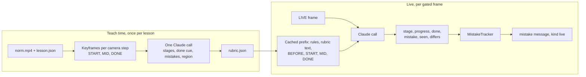

# Step understanding

Where the learner is inside a step, frame by frame, and mistakes while they happen. Code: `server/understand.py`, tests `server/test_understand.py`, benchmark `scripts/understand_bench.py`. Status: built and tested, **not wired into the engine yet** (see Integration).

Back to [server/README.md](../README.md).

The live check (`check.py`) asks one yes/no question against one picture, the end of the step. Understanding adds a rubric built once at teach time and a richer live call that reads the stage, progress and likely mistakes.

## 1. Rubric (teach time)

`await build_rubric(lesson_dir)` or `python -m server.understand --rubric lessons/<id>`.

| Part | What it does |
|---|---|
| Keyframes | For each camera step, writes `frames/NN_a.jpg` (START), `NN_b.jpg` (MID), `NN_c.jpg` (DONE). DONE is the step's `ref_frame`, so both checks agree on "finished". START and MID are the stillest frames near the step's start and middle (teach.py's stillness measure). If START looks the same as DONE (static video, a cut), the previous step's reference stands in. `--keep-frames` keeps existing files, for hand-picked frames. |
| Call | One call for the lesson: each step's title, question, narration (from `extraction.json`) and its 3 keyframes. Structured output through `output_config.format` with a flat schema. Adaptive thinking, effort medium. Budgeted through `spend.allow()` and `spend.record()`. |
| Per step | 2 to 4 stages (label and visible cue; START is never a stage), a done cue, 1 to 3 mistakes (label, visible sign, hint of at most 10 words, severity), a region box in 0..1. Counts and ranges are enforced after the call. |
| File | `lessons/<id>/rubric.json`, additive; `lesson.json` is never touched. Carries a signature of the steps, so a recut or edited question makes it stale and `load_rubric(dir, lesson)` returns None. A step the model skipped has no entry and keeps the plain check. |

## 2. Live call

`await understand_frame(entry, keyframes, live_jpeg, prev_step_ref, timeout=None)` returns `Understanding`, a `CheckResult` subclass.

| Request | Detail |
|---|---|
| Order | system rules, rubric text, BEFORE (previous step's reference), START, MID, DONE (cache breakpoint here), then LIVE and one final line |
| Dedupe | When START is the previous reference, BEFORE is not sent twice; START is labeled as both |
| Shape | JSON schema, effort low, thinking off on Haiku, no streaming, no temperature, top_p or top_k |
| Answer order | seen, differs, stage, progress, mistake (enum of the step's labels plus none), mistake_confidence, done, confidence |

| Guard | Rule |
|---|---|
| Enums | lowercased; mistake labels matched case-insensitively, unknown labels count as none |
| Contradictions | yes with a differs other than "nothing" becomes unsure; yes with a named mistake becomes unsure |
| Ranges | stage outside -1..stages-1 becomes -1; progress and confidences clamped to 0..1 |
| Not started | a mistake at stage -1 is dropped (the rubric sometimes names "not started yet" as a mistake) |
| Failures | refusal, cut-off answer, bad JSON, timeout, 429, no key, spent budget: done unsure, confidence 0, an error class the Breaker reads |
| Mock | `HANDOVER_CHECK=mock` maps check.py's mock verdict to last stage (yes) or -1 (no) |

`as_dict()` keeps `done`, `confidence`, `latency_ms`, `reason` and adds `stage`, `progress`, `mistake`, `mistake_confidence`.

## 3. Live mistake policy

`MistakeTracker` turns results into `{"type":"mistake","step","kind":"live","label","message","confidence","source"}`. It complements the behind and ahead compare in `mistake.py`.

| Rule | Default |
|---|---|
| Fire | same label in 2 results in a row, each at confidence >= 0.75 |
| Clear | the stage moves past the stage it fired at, or the label is missing from 2 results in a row, or the step changes |
| Cooldown | 8 s per label per step |
| Skipped | results with an error; they neither count nor break a streak |

## 4. Measured (synthetic renders only)

Run `scripts/out/understand-20261114-172318/report.md`: 26 frames per variant over camera steps 2, 4, 5, 6, 8 (start, real partial folds drawn with synth_folds' primitives, done, plus 5 planted mistakes). Step 8's in-between is a 50% alpha blend, a crude proxy. These are Pillow drawings, not photos.

| Metric | Haiku 5.5, 3 variants | Sonnet 5.5, 1 variant | Haiku, same variant |
|---|---|---|---|
| Progress pairs monotonic | 44/48 | 16/16 | 15/16 |
| Progress mean abs error | 0.148 | 0.096 | 0.151 |
| Stage within 1 of truth | 60/63 | 21/21 | 20/21 |
| Start read as -1 / done read as last stage | 12/15, 15/15 | 4/5, 5/5 | 4/5, 5/5 |
| Done yes on done frames | 13/15 | 5/5 | 5/5 |
| False pass on all other frames | 9/63 | 1/21 | 3/21 |
| Mistake flagged at >= 0.75 / false alarm | 2/15, 3/63 | 0/5, 0/21 | 1/5, 1/21 |
| Tracker fired on planted sequence / on clean series | 0/5, 0/15 | 0/5, 0/5 | |
| Latency p50 / p90 | 1363 / 2537 ms | 2097 / 2772 ms | 1614 / 2634 ms |
| Cost per live call | $0.00012 | $0.0032 | |
| Rubric call | $0.0023 | $0.0291 | |

Current check on the same Haiku frames: done yes 15/15, false pass 10/63, p50 1010 ms, p90 1476 ms. Requiring both to say yes (offline from the same results): done yes 13/15, false pass 4/63.

Mistake confidence threshold sweep, Haiku, per frame:

| Threshold | Detected | False alarm on clean frames | Tracker: planted / clean series |
|---|---|---|---|
| 0.5 | 12/15 | 14/63 | 4/5, 4/15 |
| 0.6 | 11/15 | 13/63 | 4/5, 4/15 |
| 0.75 | 2/15 | 3/63 | 0/5, 0/15 |

What this says:

- Progress and stage work: monotonic along a step, start and done read correctly in most frames.
- Haiku names the planted mistake in 4 of 5 sequences, the same label in every variant, but at confidence 0.6 to 0.7, the same values it gives half-finished correct frames. No threshold separates them on single frames. At 0.75 the tracker never fires; at 0.6 it catches 4/5 and false-fires on 4/15 clean series. "Flipped early" was never caught by Haiku.
- Sonnet is smoother on progress and has fewer false passes, but caught no mistakes and costs 26 times more per call. Not clearly better for its price; Haiku stays the default.
- As a done signal alone, understanding is not better than the current check. As a second vote it cuts false passes by more than half.

## 5. Limits

- Synthetic renders only, small samples (5 planted mistakes, 15 series). Re-test on real footage before trusting any number.
- The benchmark's keyframes come from clean renders (an idealized expert video); the synthetic lesson's own video is static per step.
- Expected stage is truth progress split evenly over the model's stages, so "stage exact" is approximate; "within 1" is the fairer number.
- A live call is slower than the current check: 0.35 s more at p50, 1.1 s more at p90. The first call per step writes the cache.
- Rubric labels differ between runs and models; nothing may depend on exact label text.

## 6. Settings

Read through `config.get` once registered in `server/config.py`; until then `understand.SETTINGS` holds the same defaults and bounds.

| Var | Default | Range | Meaning |
|---|---|---|---|
| `HANDOVER_UNDERSTAND_MODEL` | `claude-haiku-5-5` | any Claude model id | rubric and live model |
| `HANDOVER_UNDERSTAND_TIMEOUT` | 5 | 0.1 to 60 | seconds before a live call counts as a timeout |
| `HANDOVER_LIVE_MISTAKE_MIN_CONF` | 0.75 | 0 to 1 | minimum mistake confidence that counts |
| `HANDOVER_LIVE_MISTAKE_REPEAT` | 2 | 1 to 10 | results in a row with the same label to fire |
| `HANDOVER_LIVE_MISTAKE_CLEAR` | 2 | 1 to 10 | results in a row without the label to clear |
| `HANDOVER_LIVE_MISTAKE_COOLDOWN_S` | 8 | 0 to 600 | seconds before one label may fire again on a step |

## 7. Integration

Not done; these files are owned elsewhere.

1. `config.py`: register the six settings above, plus an engine switch `HANDOVER_UNDERSTAND` (bool, default 0).
2. `teach.py`: after the self-test, `await understand.build_rubric(lesson_dir, progress=progress)` when a Claude key is set; log and continue on RuntimeError. Recut makes the rubric stale; rebuild it after a recut.
3. `main.py`, on select and reload: `rubric = understand.load_rubric(dir, lesson)`; cache each step's keyframes like `ref_bytes`.
4. `main.py`, `_run_check`: for a camera step with a rubric entry and the switch on, call `understand_frame(entry, keyframes, frame, prev_ref, step_started_at=...)` instead of, or next to, `check_frame`. Breaker, Debouncer and `last_check` take it as is. Measured advice: keep `check_frame` as the advance signal and use understanding for progress and stage, or require both yes.
5. `main.py`, state: add `progress` (0..1 or null), `stage` (`{"index","count","label"}` or null), and let `mistake` carry kind `live` with `label`. Reset on step change.
6. `main.py`, mistakes: `tracker.start_step(step, entry)` on every step change, `tracker.reset()` on `dismiss_mistake`, `msg = tracker.feed(result, now)` after each result; broadcast `msg` and set `state.mistake`; clear `state.mistake` when it is a live one and `tracker.active` is None. Never let a live mistake move the step.
7. `CONTRACT.md` 7.2: add kind `live` with `label` and no `looks_like`, and the two state fields.
